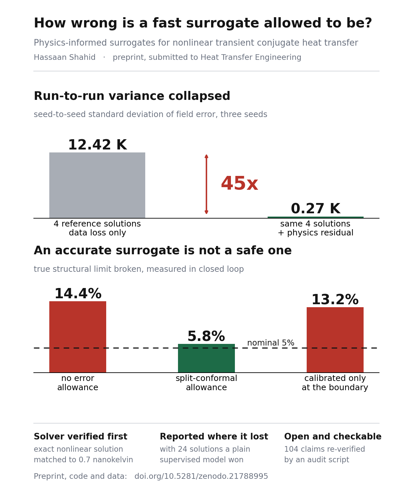
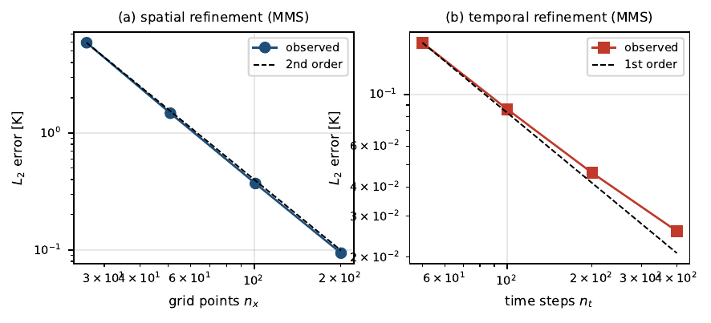
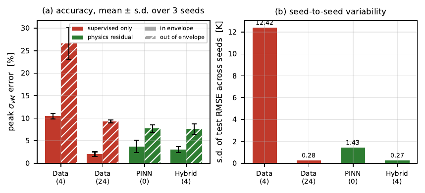
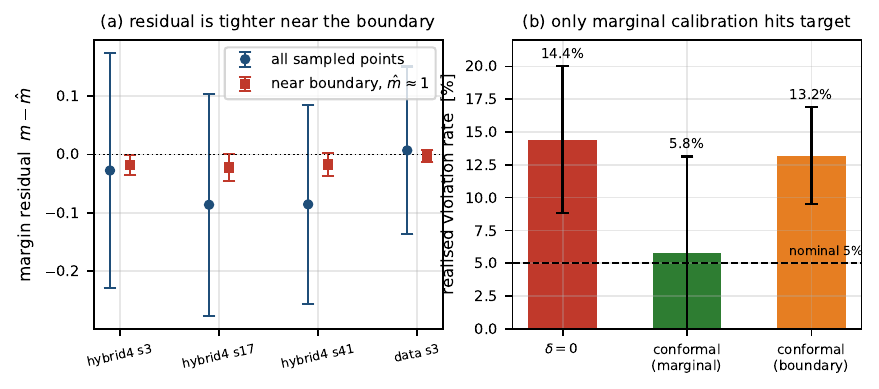
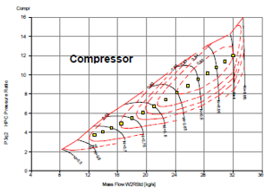
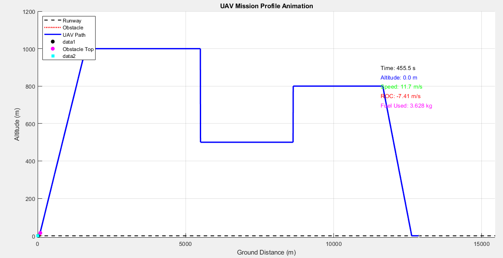
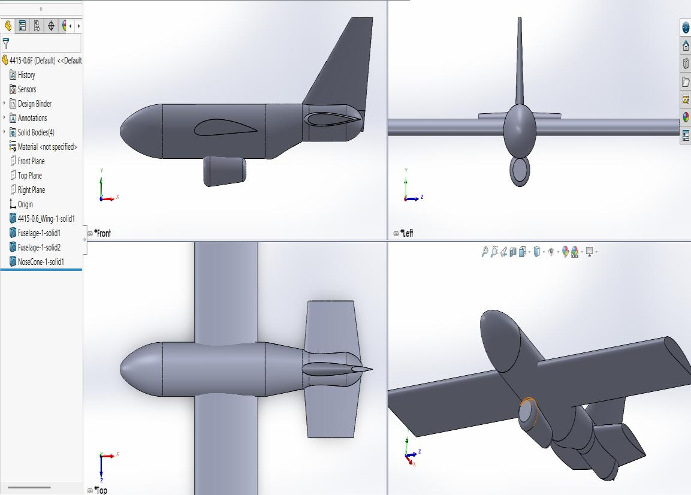
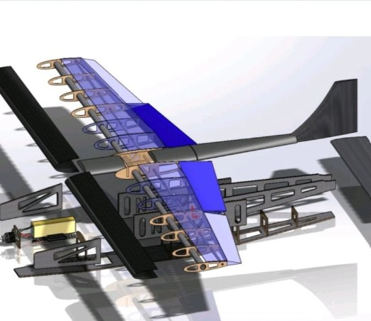

# Engineering Portfolio

### Hassaan Shahid
**M.Sc. Aeronautical Engineering, Linköping University** · Linköping, Sweden

Scientific machine learning · CFD and aerodynamics · aircraft conceptual design · flight systems and UAV test

---

## For a thesis supervisor, in thirty seconds

I am looking for a **30 hp master thesis from January to June 2027**, in scientific machine learning,
CFD, or simulation for flight systems. Here is the evidence that I can run one alone.

| What a 30 hp thesis demands | Where I have already done it |
|---|---|
| **Work independently for 20 weeks** | Posed, solved, verified and wrote up a physics-informed surrogate study alone over one summer, from problem statement to submitted manuscript. [Case study](projects/physics-informed-surrogates.md) |
| **Verify before you believe** | Reference solver verified two independent ways: exact nonlinear steady solution by Kirchhoff transform, agreeing to 7.3e-10 K, and method of manufactured solutions at observed order 2.00 in space. [How I verify](docs/verification-practice.md) |
| **Report honestly** | Measured run-to-run variance across twelve seeded runs instead of one lucky seed, showed my own accurate surrogate broke the limit on 14.4 per cent of manoeuvres, and published the regime where the method loses. |
| **Write reproducible code** | Full study reproduces in under two core-hours, MIT licensed, with an audit script that re-checks 104 quantitative claims against stored results. |
| **Handle large simulations** | RANS on a 3.2 million element near-wall mesh with turbulence model comparison and convergence studies. [Case study](projects/vehicle-aero-rans-spoiler.md) |
| **Bridge model and hardware** | Built a hardware-in-the-loop Iron Bird and reconciled measured actuator latency against the Simulink model. [Case study](projects/hil-iron-bird.md) |
| **Write and present** | Sole-authored manuscript, competition technical reports, three years teaching physics, team captain of a multidisciplinary student team. |

**Where I would fit:** [four concrete thesis directions with readiness and gaps](docs/thesis-readiness.md).

---

## Projects

Fifteen projects, grouped by discipline. The first column links to a full case study with problem,
method, setup numbers, verification, results and limitations.

### Scientific machine learning and numerical methods

| Project | Headline result | Evidence |
|---|---|---|
| **[Physics-informed surrogates with calibrated error bounds](projects/physics-informed-surrogates.md)** | Physics residual cut seed-to-seed error standard deviation from 12.42 K to 0.27 K, a **factor of about 45**; used as a hard constraint the surrogate violated the limit on **14.4 per cent** of manoeuvres, and a split-conformal allowance restored the nominal 5 per cent | [preprint](https://doi.org/10.5281/zenodo.21788995) · [code](https://github.com/hassaanshahid97-cyber/scramjet-pinn-surrogate) |
| **[Micro gas turbine design and performance code](projects/uav-gas-turbine-code.md)** | Offline C++ and NPSS tool answering "can this airframe, with this engine, clear the obstacle at this weight?", benchmarked on the AMT Olympus HP 230N. Nominated Best Final Year Project | [archive](https://doi.org/10.5281/zenodo.21805835) · [code](https://github.com/hassaanshahid97-cyber/uav-gas-turbine-performance-tool) |

### CFD and aerodynamics

| Project | Headline result | Evidence |
|---|---|---|
| **[Vehicle aerodynamics and rear spoiler, RANS](projects/vehicle-aero-rans-spoiler.md)** | Turbulence model validated before the design study; rear spoiler converted near-neutral lift into **C_L = -0.094**, 4.61 N of downforce, for a **5.7 per cent** drag penalty. 3.2M element mesh at y+ < 5, Re = 588,000 | TMMV08, 2026 |
| **[Shock structure in a convergent-divergent nozzle](projects/cd-nozzle-shock-analysis.md)** | Oblique and normal shock interaction traced from inlet to exit, reviewed and approved by fluid dynamics faculty | 2023 |

### Aircraft conceptual design

| Project | Headline result | Evidence |
|---|---|---|
| **[SKYLIGHT new midsize aircraft](projects/skylight-midsize-airliner.md)** | Converged 252 passenger airliner at Mach 0.77 and 212,957 kg, sized against FAR Part 25 | TMAL51, 2026 |
| **[Heavy-lift electric UAV, SAE Brasil AeroDesign](projects/sae-heavy-lift-uav.md)** | Static margin held positive through mid-air release of a 1.0 kg glider, **14.2 to 16.3 per cent**; NACA 2415 cut zero-lift pitching moment **53 per cent** | TMAL06 and Team Findus, 2026 |
| **[EH-5963 wide-body design study](projects/eh-5963-widebody.md)** | Full conceptual cycle for a 530 passenger Mach 0.86 aircraft, Raymer RDS, Datcom, CATIA V5 | 2023 to 2024 |
| **[Boeing C-17 performance study](projects/c17-performance-study.md)** | Complete envelope: steady, accelerated, turning, climbing, take-off and landing. Graded 90 of 100 | 2023 to 2024 |

### Design automation

| Project | Headline result | Evidence |
|---|---|---|
| **[Parametric UAV fuselage and landing gear configurator](projects/parametric-uav-configurator.md)** | Eight-stage PowerCopy workflow builds bulkheads, longerons, skin and gear from payload inputs, with CG and gear stations computed live | [code](https://github.com/hassaanshahid97-cyber/catia-v5-fuselage-configurator) |

### Flight systems, controls and test hardware

| Project | Headline result | Evidence |
|---|---|---|
| **[Hardware-in-the-loop and Iron Bird framework](projects/hil-iron-bird.md)** | Pixhawk 6X and ArduPlane closed onto X-Plane over MAVLink; C_L alpha and C_m q validated under gust against Simulink | NaqCoDE, 2024 |
| **[Twin Rotor Aerodynamical System rig](projects/twin-rotor-aerodynamical-system.md)** | Built a helicopter-like nonlinear cross-coupled plant with encoder and rotor speed instrumentation for system identification | 2022 to 2023 |
| **[Ultrasonic occupant counter](projects/ultrasonic-occupant-counter.md)** | Real-time bidirectional counting with logic written against the failure cases, not the happy path | 2024 |

### Built and flown

| Project | Headline result | Evidence |
|---|---|---|
| **[Stellar-X surveillance UAV](projects/stellar-x-surveillance-uav.md)** | 5.0 kg MTOW, 1.69 m span, 26.5 m/s cruise, 50 min endurance | 2024 to 2025 |
| **[Orbit-X composite UAV](projects/orbit-x-composite-uav.md)** | Carbon fibre, NACA 0015, 2.4 kg MTOW, **38 m STOL**, servo-actuated payload drop, Level 1 autonomy | 2024 to 2025 |
| **[KIRA-9 propeller-driven UAV](projects/kira-9-uav.md)** | Designed, built and flown inside two months. Part of a competition cycle won in 2023 and 2024 | 2024 |

---

## Capability matrix

Depth is honest: **used in anger** means it carried a deliverable; **working** means I have used it
under supervision or on a single project; **aware** means I can read it and would need a ramp-up.

| Capability | Level | Where |
|---|---|---|
| Physics-informed neural networks, JAX, automatic differentiation | Used in anger | Preprint, sole-authored |
| Conformal prediction and uncertainty quantification | Used in anger | Preprint, split-conformal allowance in closed loop |
| Finite volume PDE solvers, nonlinear transient | Used in anger | Reference solver written and verified from scratch |
| Verification by manufactured solutions, convergence studies | Used in anger | Preprint, RANS study |
| ANSYS Fluent, RANS, turbulence model selection, near-wall meshing | Used in anger | TMMV08, nozzle study |
| Aircraft conceptual design, sizing, stability, FAR Part 25 | Used in anger | SKYLIGHT, EH-5963, SAE UAV |
| Gas turbine cycle modelling, NPSS, engine maps | Used in anger | Degree project |
| CATIA V5 API automation, VB.NET, knowledge-based engineering | Used in anger | TMKT57 configurator |
| SOLIDWORKS, CAD for manufacture, composites | Used in anger | Stellar-X, Orbit-X, KIRA-9 |
| Hardware- and software-in-the-loop, Pixhawk, ArduPlane, MAVLink | Used in anger | NaqCoDE Iron Bird |
| MATLAB and Simulink modelling | Used in anger | Degree project, HIL validation, teaching |
| Python scientific stack, Git, reproducible research practice | Used in anger | Preprint repository |
| C++ | Working | Degree project tool |
| Finite element analysis | Working | Coursework, TMHL63 |
| GPU and high-performance computing for wave propagation | Aware | Named target for my thesis, see [thesis readiness](docs/thesis-readiness.md) |
| Synthetic aperture radar and electromagnetic scattering | Aware | Same |

---

## Selected figures

| | | |
|:---:|:---:|:---:|
|  **Solver verification** Manufactured solutions, order 2.00 spatial |  **Seed variability** 12.42 K to 0.27 K across seeds |  **Calibrated allowance** Nominal violation rate restored |
|  **Compressor map** Olympus HP 230N benchmark |  **Mission simulation** Second by second, with payload drop |  **Airframe integration** Engine and airframe matched |
|  **Stellar-X** 5.0 kg, 50 min endurance |  **Orbit-X** Carbon fibre, 38 m STOL |  **SAE heavy-lift** Team captain, systems lead |

---

## How I work

Three habits show up in every project here, and they are the reason I would back my own results.

**Verify the tool before trusting the answer.** A solver is not correct because it runs. In the
preprint the reference solver was checked against an exact nonlinear steady solution and separately
against manufactured solutions, and only then used to generate training data. The same instinct shows
up in the RANS study as a turbulence model comparison before any geometry conclusion.
[Full account](docs/verification-practice.md)

**Report the variance, not the best run.** Twelve replicated runs instead of one. The interesting
finding of the preprint is about variance, and it would have been invisible at a single seed.

**State the cost with the gain.** The spoiler bought downforce and it cost 5.7 per cent drag. Both
numbers are in the result, because a design decision needs both.

---

## Credentials and competitions

| | |
|---|---|
| **Publication** | Shahid, H. (2026). *Seed Variability and Calibrated Error Bounds for Physics-Informed Conjugate Heat Transfer Surrogates.* Zenodo. [10.5281/zenodo.21788995](https://doi.org/10.5281/zenodo.21788995). Sole-authored, submitted to a peer-reviewed journal August 2026, not yet reviewed |
| **Archive** | Shahid, H. and Sabir, M. B. (2025). Micro gas turbine design and performance code. Zenodo. [10.5281/zenodo.21805835](https://doi.org/10.5281/zenodo.21805835) |
| **Competitions** | Winner, National Design-Build-Fly Competition, 2023 and 2024. Runner-up, UCP Taakra AeroDesign, 2023. Nominated, Best Final Year Project 2025, IST |
| **Licences** | EASA UAS A1/A3 Open Subcategory remote pilot, valid to 2031. Certified Engineer Aerospace, Sveriges Ingenjörer, SeQF level 6. Registered aeronautical engineer, Pakistan Engineering Council |
| **Certifications** | Certified SOLIDWORKS Associate: Design (CSWA), xDesign, Additive Manufacturing and Sustainability, Dassault Systèmes |
| **Memberships** | Royal Aeronautical Society; AIAA, young professional |
| **Languages** | English fluent, IELTS 7.5, CEFR C1. Swedish A2, studying SFI at Linköping kommun. Urdu and Punjabi mother tongue |

---

## Academic record

**M.Sc. Aeronautical Engineering**, Linköping University, Aug 2025 to Jun 2027, 120 ECTS.
Average **4.25 of 5.0** across 54 ECTS completed. Thesis period from January 2027.
Grade 5 in Aerodynamics, Flight Mechanics, Engineering Systems Design and Aircraft Systems.
Registered 2026/2027: Machine Learning for Mechanical Engineering, Computational Fluid Dynamics,
Model-based System-of-Systems Engineering, Aircraft Systems Engineering Project, Gas Turbine Engines,
Prototype Realization.

**B.Sc. Aerospace Engineering**, Institute of Space Technology, Pakistan, Sep 2021 to Jul 2025,
CGPA 3.38 of 4.0. Numerical analysis, differential equations, linear algebra, control systems,
flight control systems, spacecraft dynamics and control, rotorcraft dynamics, flight dynamics and
stability, aerospace vehicle design.

---

## Contact

**Hassaan Shahid** · Linköping, Sweden
[hassaanshahid97@gmail.com](mailto:hassaanshahid97@gmail.com) ·
[LinkedIn](https://www.linkedin.com/in/hassaan-shahid-b1b285280) ·
[GitHub](https://github.com/hassaanshahid97-cyber) ·
[ORCID 0009-0003-7403-8933](https://orcid.org/0009-0003-7403-8933) ·
[hassaanshahid97-cyber.github.io](https://hassaanshahid97-cyber.github.io)

Academic references are listed on my CV and available on request, from Linköping University and the
Institute of Space Technology.

---

Every number on these pages comes from my own reports, code and the linked repositories. Where a
result is unpublished coursework, the course code and year are given so it can be checked. Text and
figures released under [CC BY 4.0](LICENSE); code in the linked repositories under MIT unless stated
otherwise.
