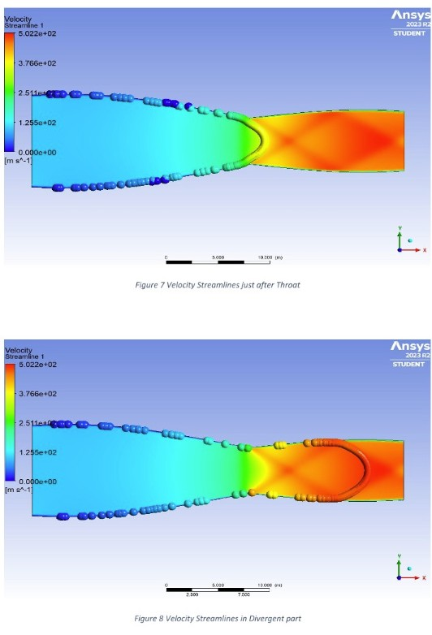

# Shock structure in a convergent-divergent nozzle

**Sep 2023 to Nov 2023 · compressible aerodynamics, Institute of Space Technology**

## Objective

Computational investigation of internal compressible aerodynamics in an indigenously designed
convergent-divergent nozzle, focused on the formation and interaction of oblique and normal shocks.

## Method

- ANSYS Fluent, compressible flow, density-based solver
- Shock formation and propagation traced from inlet through throat to exit
- Effect on flow parameters analysed region by region, including total pressure loss across the
  shock system
- Results reviewed and approved by fluid dynamics faculty

## Outcome

A clear picture of how the oblique and normal shock system sets the exit condition of the nozzle, and
of how far the design deviates from ideal isentropic expansion at off-design pressure ratio.
