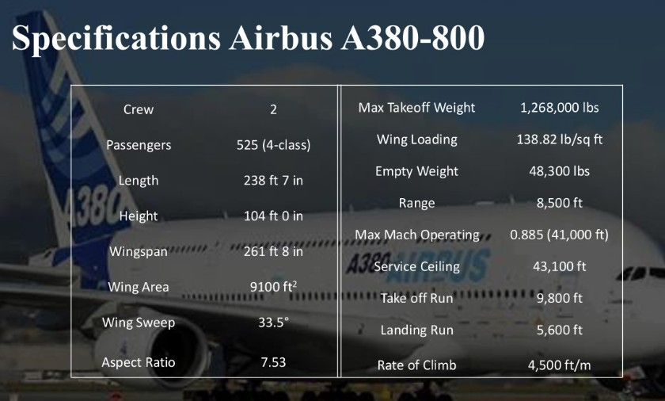

# EH-5963 wide-body aircraft design study

**Aug 2023 to Feb 2024 · aerospace vehicle design, Institute of Space Technology**

## The aircraft

| Parameter | Value |
|---|---|
| Passengers | 530 |
| Cruise Mach number | 0.86 |
| Configuration | Wide-body, twin-aisle |

## Method

Full conceptual design cycle: mission definition, initial sizing, configuration layout, aerodynamic
build-up, weights, performance and stability, using **Raymer's RDS**, **Datcom** for stability and
control derivatives, and **CATIA V5** for the configuration model.

## Outcome

A converged wide-body configuration with a documented design rationale, sized against its mission and
checked for longitudinal and directional stability across the envelope.
