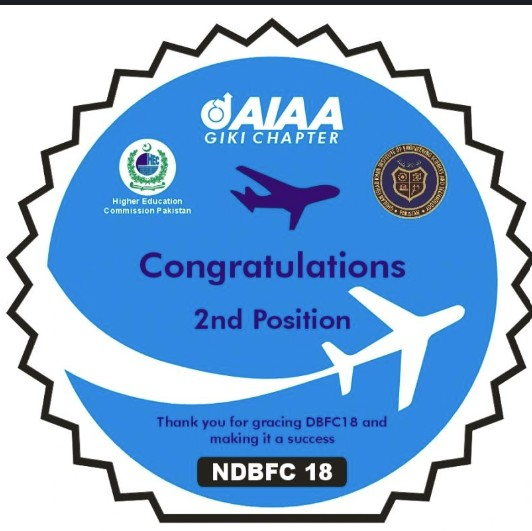
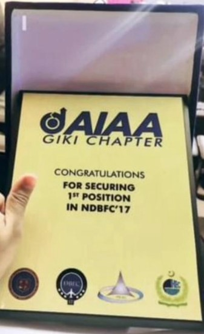

# KIRA-9 propeller-driven UAV

**National competition build, Institute of Space Technology · January to February 2024**

| | |
|---|---|
| **Aircraft** | Single-engine high-wing competition aircraft |
| **Timescale** | Designed, built and flown inside two months |

## Build

| Item | Implementation |
|---|---|
| Configuration | Single engine, high wing, propeller driven |
| Structure | Carbon fibre and XPS foam |
| Wing | Custom spars sized for the competition load case |
| Status | Built and flown |

## The constraint that shapes every decision

The calendar. In a two-month design-build-fly cycle the airframe has to be manufacturable and
repairable by the same people who designed it, using what is in the workshop. That rules out
configurations that are aerodynamically better and structurally slower, and it rewards a design whose
failure modes are repairable between flights.

This build sits inside the competition cycle in which the team took **first place in the National
Design-Build-Fly Competition in 2023 and 2024**.

 

## Relevance

Rapid iteration under a hard deadline, composite and foam construction, spar sizing, and flight test
under competition rules.

[Back to portfolio](../README.md)
