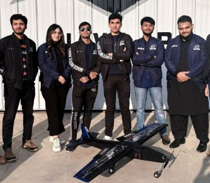

# Orbit-X composite UAV

**2024 to 2025 · final year aerospace engineering team build, Institute of Space Technology**

 

## The aircraft

A carbon fibre composite UAV built for aerodynamic efficiency, designed, fabricated and piloted by
final year aerospace engineers.

| Parameter | Value |
|---|---|
| Configuration | High-wing monoplane |
| Airfoil | NACA 0015 |
| Maximum load factor | 3g |
| MTOW | 2.4 kg |
| STOL take-off distance | 38 m |

## Systems

- **Automation:** Level 1 autonomy on Pixhawk, covering take-off, landing, stabilise and return to
  launch
- **Mission:** payload-drop mechanism with servo-actuated precision targeting
- **Structure:** carbon fibre composite primary structure, laid up in house

## Skills demonstrated

Composite design and fabrication, autopilot configuration and tuning, mission system integration, and
flight test as the pilot of the aircraft you designed.
