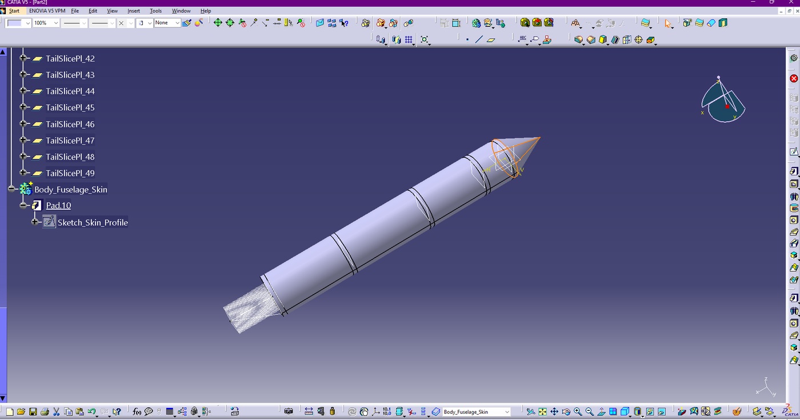
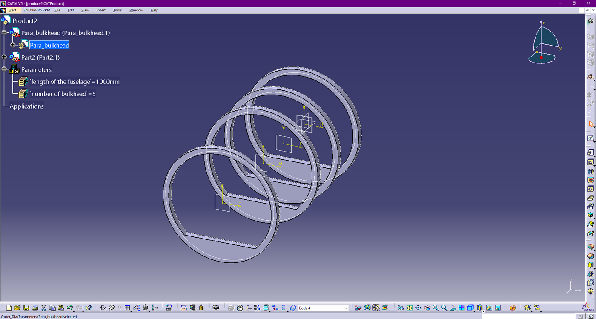
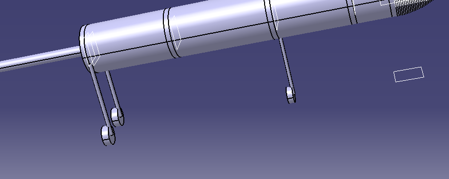

# Mission-driven UAV fuselage and landing gear configurator

**TMKT57 Product Modelling, Linköping University · March to June 2026**

| | |
|---|---|
| **Context** | TMKT57 Product Modelling, Group 22, Linköping University. Built to serve the Team Findus SAE BRASIL AeroDesign aircraft |
| **Team** | Hassaan Shahid, Momin Ali Khan, Sachin Chandima. Group 21 owned the wing and empennage; Group 22 owned internal integration |
| **My contribution** | Parametric builder and the PowerCopy approach, two independent Visual Studio project versions |
| **Tools** | VB.NET, Visual Studio, CATIA V5 Interop COM API, SQLite |
| **Code** | [catia-v5-fuselage-configurator](https://github.com/hassaanshahid97-cyber/catia-v5-fuselage-configurator) |

> **Takeaway for a supervisor:** this is knowledge-based engineering with the design rules actually
> encoded. The tool does not just rebuild geometry from parameters; it computes centre of gravity and
> landing gear stations from the payload, so a mission change propagates into a structurally
> consistent airframe.

---

## 1. Problem

Manual layout of UAV internal structure is slow and error-prone during conceptual iteration. Every
time the payload or the mission changes, someone re-places bulkheads, re-checks the centre of gravity,
and moves the landing gear. The work is repetitive, it is exactly the part where a human makes
mistakes, and it is not the part where a human adds value.

The goal was stated as **efficient modelling, not total automation**: remove the non-creative work so
the engineer spends the time on the decisions.

---

## 2. Architecture

```
 Mission and payload inputs
            |
   VB.NET Windows Forms GUI          input validation, mission rules,
            |                        live status console
   Automation layer
            |                        CATIA V5 Interop COM API
   CATIA V5 part and product         8-stage PowerCopy build sequence
            |
   SQLite configuration store        save and recall standard layouts
```



The specification tree on the left is the output of the tool, not of a person: tail slice planes,
skin body, pads and sketches, all instantiated by the automation layer.

---

## 3. Inputs and the rules that act on them

| Category | Primary parameters | What it drives in the model |
|---|---|---|
| Payload | Mass in kg, bounding box in mm | Fuselage width and height |
| Performance | Target endurance, take-off run | Fuselage length, motor class |
| Structure | Material, balsa or plywood | Rib spacing and thickness |
| Stability | Gear type, tricycle or tail-dragger | Wheelbase placement |

The VB.NET layer computes the X-station of every internal item **before** CATIA is triggered:

```
Fuselage_Length = f(Payload, Battery_Volume)
CG_System       = sum(Mass_i * X_i) / Total_Mass
Gear_Station_X  = CG_System + Offset_K
```

This ordering is the point. Geometry is generated from a resolved layout rather than generated and
then checked, so the model cannot end up in a state where the gear is in front of the centre of
gravity by accident.

---

## 4. The PowerCopy structural library

Five reusable PowerCopies form the semi-monocoque fuselage:

| PowerCopy | Purpose |
|---|---|
| Bulkheads | Key payload boundaries |
| Frames | Light intermediate support |
| Stringers and longerons | Stiffeners |
| Lightening holes | Patterned cut-outs for weight |
| Skin and nose | Outer surface and aerodynamic nose |





Representative generated geometry, from the repository build:

| Feature | Implementation |
|---|---|
| Bulkheads | Five hollow rectangular frames, sketched on the YZ plane and slid to station by `Pad.OffsetLength` |
| Longerons | Four corner members, same sketch-and-offset strategy |
| Aerodynamic nose | Revolved ogive profile, 250 mm ahead of bulkhead 1 |
| Tail boom | Rectangular pad extending 200 mm behind bulkhead 5 |
| Skin | Four loft-driven panels of variable thickness, 5 down to 2 mm |
| Nose gear | Single 6 mm strut dropping 250 mm from bulkhead 2 at X = 450 mm |
| Main gear | Twin 8 mm struts at plus and minus 90 mm lateral offset from bulkhead 4 at X = 1200 mm, dropping 320 mm |

---

## 5. Two COM interop problems worth recording

Both are the kind of detail that is invisible in a report and costs a day in practice.

**Offset planes rejected as sketch supports.** The first approach sketched each bulkhead on a
`HybridShapeOffset` plane offset from the YZ plane. `AddNewPad()` refused those planes as sketch
supports and threw a type-mismatch COM error. The fix was to change strategy rather than fight the
API: always sketch on the standard YZ plane, then use the `Pad.OffsetLength` property to slide the
resulting solid to its X station. That unlocked all five bulkheads at once, and the four longerons
followed the same pattern.

**Optional arguments are not optional.** Passing `Nothing` to the optional third argument of
`AddSectionToLoft()` raised "parameter not optional" at runtime. VB.NET COM interop does not behave
like VBScript here; the argument has to be omitted entirely rather than passed as `Nothing`.

Full development narrative, with screenshots of each stage:
[IMPLEMENTATION_LOG.md](https://github.com/hassaanshahid97-cyber/catia-v5-fuselage-configurator/blob/main/IMPLEMENTATION_LOG.md)

---

## 6. Competition constraints encoded in the tool

Because the configurator serves a real SAE aircraft, competition rules are hard-coded rather than
remembered:

- **Shipping box limits** are enforced in the GUI, so a design that cannot be transported cannot be
  generated
- **Material presets** for 1/8 inch balsa, 3 mm plywood and spruce stringers, sized for direct
  laser-cutting output
- **Automated lightening hole patterns** on frames, to maximise payload capacity within the empty
  weight bonus

---

## 7. Outcome

- Stable connection demonstrated between a standalone VB.NET application and the CATIA V5 COM API
- Reliable **eight-stage** automated build, from internal bulkheads and longerons through skin to
  landing gear, with no manual intervention
- User-defined numerical inputs translated directly into a precise 3D structural model
- Live status console in the GUI tracking stage completion during generation
- A working configurator that removes manual drafting time from initial UAV fuselage conceptualisation

---

## 8. What I would do differently

- **Validate the generated structure, not only build it.** The tool produces a geometrically
  consistent airframe. It does not yet check that the structure carries the load case, and a finite
  element pass driven from the same parameters is the obvious next stage.
- **Round-trip the mass properties.** Centre of gravity is computed from input masses. Reading the
  mass properties back out of the generated CATIA model and comparing would close the loop and catch
  a geometry-versus-intent mismatch.
- **Regression test the build.** Eight stages of COM calls against a third-party application is
  exactly the code that breaks silently on a CATIA version change. A scripted build of three known
  configurations, compared against stored outputs, would catch that.
- **Decouple from CATIA.** The rules layer is genuinely reusable; the geometry layer is not. Splitting
  them would let the same mission logic drive a different CAD backend.

---

## 9. Relevance to a master thesis

Design automation and knowledge-based engineering sit directly next to my autumn course TMKU01 Design
Automation of Customised Products, and next to multidisciplinary design optimisation, where a
parametric model that regenerates reliably is the precondition for any optimisation loop. This project
is evidence that I can build one that holds together across eight stages and a hostile API.

[Code](https://github.com/hassaanshahid97-cyber/catia-v5-fuselage-configurator) ·
[Thesis readiness](../docs/thesis-readiness.md) · [Back to portfolio](../README.md)
