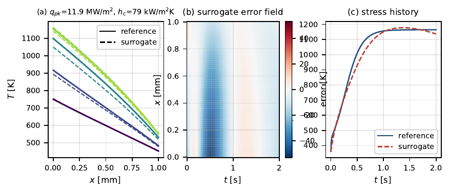
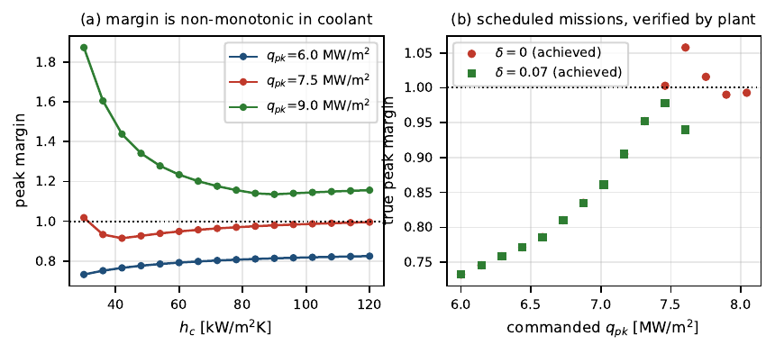

# Physics-informed surrogates with calibrated error bounds

**Independent research · June to August 2026 · sole-authored, under review**

| | |
|---|---|
| **Context** | Self-directed, unsupervised, over one summer between semesters |
| **Output** | Sole-authored paper, *Seed Variance and Calibrated Constraint Bounds for Physics-Informed Surrogates in Thermal Decision Loops*, under review at *Engineering Applications of Artificial Intelligence* (Elsevier). The Zenodo preprint carries the earlier working title |
| **DOI** | [10.5281/zenodo.21788995](https://doi.org/10.5281/zenodo.21788995) |
| **Code** | [scramjet-pinn-surrogate](https://github.com/hassaanshahid97-cyber/scramjet-pinn-surrogate), MIT, manuscript CC BY 4.0 |
| **Stack** | JAX with automatic differentiation, NumPy, SciPy, LaTeX |
| **Reproduces in** | Under two core-hours from a clean checkout |


> **Takeaway for a supervisor:** this is a complete research loop run alone, at thesis scale, with the
> uncomfortable results left in. It is the closest thing to a 30 hp thesis I can show before I start
> one.

---

## 1. The question

A physics-informed surrogate is easy to demonstrate and hard to qualify. Two questions decide whether
it is usable rather than merely demonstrable, and both are routinely left unanswered:

1. **How much of the reported accuracy survives a change of random seed?**
2. **How large an error allowance does a decision rule need in order to stay safe?**

The application is thermostructural limit protection in a regeneratively cooled structure, where a
fast model has to sit inside a coolant scheduler and the consequence of an optimistic prediction is a
violated structural limit.

---

## 2. Pipeline

```
cht_solver.py        finite volume reference solver, temperature-dependent k and cp
      |
verify_solver.py     Kirchhoff exact solution + method of manufactured solutions
      |              agrees to 7.3e-10 K, observed orders 2.00 spatial / 0.95 temporal
      |
datagen.py           Latin hypercube design over peak flux and film coefficient
      |
train.py + pinn.py   4 configurations x 3 seeds = 12 runs, JAX autodiff
      |         \
evaluate.py    conformal.py     held-out accuracy and latency / split-conformal allowance
      \         /               with closed-loop violation rate
       audit2.py                re-checks 104 claims against stored JSON
```

**The order is the method.** The solver is verified before a single surrogate is trained, so surrogate
error can never be confused with discretisation error.

---

## 3. Verification, before anything else


| Check | Result |
|---|---|
| Exact nonlinear steady solution via Kirchhoff transform | agreement to **7.3 × 10^-10 K** |
| Method of manufactured solutions, spatial | observed order **2.00**, design 2 |
| Method of manufactured solutions, temporal | observed order **0.95**, design 1 |
| Grid independence at production resolution | 0.017 K peak temperature, 0.001 per cent peak stress |

Discretisation error sits two to three orders of magnitude below surrogate error, so it cannot
contaminate any comparison that follows.

Two deliberate numerical choices, both recorded in the repository with their reasoning: the
arithmetic-mean face conductivity reproduces the Kirchhoff integral exactly for a linear k(T), which
is why the steady test reaches machine precision rather than truncation error; and backward Euler was
chosen over Crank-Nicolson because it is L-stable and does not oscillate on the sharp boundary-data
transient. For a verification reference, robustness beats formal order when the time step is cheap.

---

## 4. Result 1, the residual substitutes for reference data

Four configurations at **identical architecture** (7,345 parameters) and **identical optimiser budget**
(1,500 Adam plus 300 L-BFGS), three seeds each. Errors are mean plus or minus sample standard
deviation over seeds.

| Configuration | CHT solutions | Residual | In-envelope RMSE [K] | In-envelope stress error [%] | Out-of-envelope stress [%] |
|---|---:|:---:|---|---|---|
| Data (4) | 4 | no | 41.26 ± 12.42 | 10.47 ± 0.63 | 26.62 ± 3.53 |
| Data (24) | 24 | no | **6.70 ± 0.28** | **2.05 ± 0.50** | 9.26 ± 0.33 |
| PINN (0) | 0 | yes | 15.94 ± 1.43 | 3.75 ± 1.40 | 7.70 ± 0.86 |
| Hybrid (4) | 4 | yes | 13.59 ± 0.27 | 3.02 ± 0.66 | **7.61 ± 1.16** |

Given four reference solutions, adding the residual improves stress error **3.5 times**. Trained on
**zero** reference solutions, the residual-only surrogate still beats a supervised model given four.
Where each reference solution is an expensive three-dimensional computation, that is the difference
between a feasible and an infeasible training campaign.



---

## 5. Result 2, it collapses run-to-run variance


The seed standard deviation of field RMSE falls from **12.42 K to 0.27 K**, a factor of about **45**,
at identical data, architecture and budget.

**A single-seed study cannot see this at all.** The supervised model drives its training loss to
1.1e-5, fitting its four points essentially perfectly; where it lands *between* those points still
depends strongly on initialisation. The residual removes that freedom.

For deployment this may matter more than the mean. A surrogate whose accuracy depends on the random
seed is hard to qualify, because the artefact you verified is not obviously the artefact you will use.

---

## 6. Result 3, an accurate surrogate is not a safe one


The surrogate was used as a **hard inequality constraint** in a coolant scheduler, across four
independently trained models.

| Error allowance | Measured violation rate |
|---|---|
| delta = 0 | **14.4 per cent** |
| Split-conformal, marginal calibration | **5.8 per cent**, nominal 5 |
| Split-conformal, boundary-restricted | 13.2 per cent |

The optimiser drives the prediction to the constraint boundary and spends whatever optimism the model
carries there. This happens **even though the mean margin residuals are conservative**, between -0.03
and -0.09, because the residual distributions carry a long right tail with maxima between 0.73 and
1.93.

Calibrated delta ranges from **0.0096 to 0.1413** across surrogates of identical architecture, a
factor of 15. **The allowance is a property of the trained model** and has to be measured after
training, never assumed.

### The obvious refinement does not work

Calibrating only near the constraint boundary, where the optimiser actually selects, sounds strictly
better. It gives 13.2 per cent, statistically indistinguishable from no allowance at all. Two effects
combine: **sample starvation**, since the band holds only 26 to 27 of 120 calibration points, so at
alpha = 0.05 delta becomes the maximum of a small sample, a high-variance estimator; and the **wrong
conditioning variable**, because a band in predicted margin is not the selection distribution the
optimiser induces. It is recorded in the repository because it is the natural first thing to try.

### More coolant is not automatically safer



Raising the film coefficient lowers the temperature level, which raises yield strength steeply and
helps; but it also stiffens the wall as E·alpha/(1-nu) rises, and steepens the through-thickness
gradient because k_s(T) falls too, both of which hurt. At q_pk = 8 MW/m2, raising h_c from 30 to
120 kW/(m2K) cools the hot face from 1068 K to 928 K but increases the temperature difference from
402 K to 461 K and peak stress from 735 to 891 MPa.

**The feasible set is an interval, not a half-line**, so a scheduler has to search it rather than
bisect. That is a result about the physics, found because the study looked.

---

## 7. Result 4, where the method loses

Reported because it is what the experiment shows, not because it flatters the approach.

With **24 reference solutions over two parameters, a plain supervised model was twice as accurate
in-envelope.** The residual loss contains second derivatives of the network with respect to its inputs
and is a substantially stiffer objective: it plateaus near 1.8e-3 while supervised runs reach about
2e-5 at the shared budget. A dense design over two parameters also leaves little estimation error for
a physics prior to remove.

The balance is expected to shift as parameter dimension grows, since design count for a fixed fill
distance grows with dimension while Monte Carlo collocation does not. **That is an expectation, not a
result of this work**, and it is labelled as such in the manuscript.

---

## 8. Reproducibility

| Practice | Instance |
|---|---|
| Full study from clean checkout | under **two core-hours** |
| Manuscript claims re-checked against stored results by script | **104 of 104** |
| Licensing | code MIT, manuscript CC BY 4.0, both published with the data |
| Experiment design | seeds, configurations and budgets recorded, not described |

The audit script is the part I would recommend to anyone: it reads the numbers in the manuscript and
compares them against the stored result files, so a figure regenerated after a code change cannot
silently disagree with the text.

---

## 9. What I would do differently

- **More seeds.** Three seeds per configuration is enough to expose a factor-of-45 variance
  difference and not enough to put a confidence interval on it. Ten would cost little at this scale.
- **Higher parameter dimension.** The one clean loss for the method happens in exactly the regime
  where the physics prior has least to add. The interesting experiment is three or four parameters,
  which is the claim currently left as an expectation.
- **A second geometry.** All results sit on one problem. Portability of the calibrated allowance
  across geometries is untested and is the first question a reviewer should ask.
- **GPU scaling.** The study was designed to reproduce on a laptop. That was the right call for
  reproducibility and the wrong call for finding out where the method breaks under load.

---

## 10. Relevance to a master thesis

This is the same loop that a physics-informed inverse problem needs: a verified forward model, a
learned surrogate whose variance is measured, and a bound whose coverage is checked in the loop where
the number is actually used. I ran it alone, to a manuscript now under review, in one summer.

[Code and audit script](https://github.com/hassaanshahid97-cyber/scramjet-pinn-surrogate) ·
[Preprint](https://doi.org/10.5281/zenodo.21788995) ·
[How I verify](../docs/verification-practice.md) ·
[Thesis readiness](../docs/thesis-readiness.md) · [Back to portfolio](../README.md)
