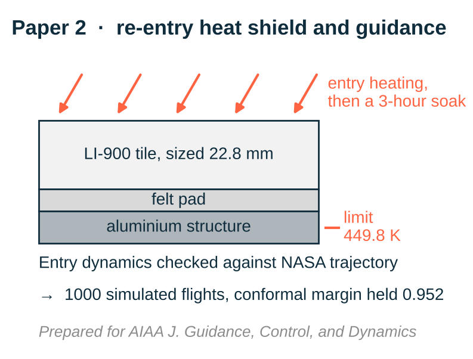

# Bondline-temperature-constrained entry guidance

**Independent research · 2026 · sole-authored, in preparation for the AIAA Journal of Guidance, Control, and Dynamics**

[Back to portfolio](../README.md)

| | |
|---|---|
| **Context** | Self-directed second study, following the [physics-informed surrogates](physics-informed-surrogates.md) paper |
| **Output** | Manuscript in preparation: *Bondline-Temperature-Constrained Entry Guidance from the Heat-Load-Optimal Drag Profile* |
| **Stack** | Python, NumPy, SciPy, Numba, Runge-Kutta integration, predictor-corrector guidance, Monte Carlo, conformal prediction |
| **Checks** | 84 automated checks of every number in the manuscript |

---

## 1. The question

Heat-shield tiles on a Shuttle-class vehicle are sized so the aluminium structure underneath stays
below **449.8 K (350 °F)**. That temperature peaks near landing, long after the guidance has finished
flying the vehicle. Can the guidance law steer so the structure stays cooler while still reaching the
same runway?

## 2. What I built

- 3-degree-of-freedom entry dynamics over a rotating Earth, verified against an independent inertial
  integration (0.07 m over 9017 km); 1976 Standard Atmosphere; NASA orbiter aerodynamics, where the
  check caught a swapped axial and normal force column in the source table
- Full mission heating through descent, approach and a 3-hour soak, and a tile-stack conduction model
  (LI-900, felt pad, aluminium) at observed orders 2.0 and 0.99 with energy closed to 1e-15; tile
  sized at 22.8 mm
- Numerical predictor-corrector guidance checked against NASA's reference trajectory:
  **1262 s against 1254 s**, **1.28 g against 1.33 g**
- The drag profile that gives the least heat load for a fixed landing site, and a guidance law built on
  it, with an onboard thermal model and a conformal margin

## 3. Results

| Result | Number |
|---|---|
| Warmer starting structure tolerated, 2 g / 2.5 g load-factor limit | **8 K / 12 K** |
| Share of 1000 Monte Carlo flights above 449.8 K | **5.8 % to 3.4 %** at 2 g, **2.5 %** at 2.5 g |
| Two-term heat-load formula against the full model | within **1.3 K** |
| Conformal margin coverage under guidance feedback | **0.952** against 0.95 |

The range fixes how long the vehicle flies at its load-factor limit, and the law picks the lowest load
factor that keeps the structure inside the limit. Most of the remaining risk comes from uncertainty in
the tile material properties.

## 4. Where it loses

At a fixed landing site guidance has little authority over the temperature rise, so most of the margin
has to come from tile design, landing-site choice and the starting temperature, not from steering.
Because the physics model runs in milliseconds and a two-term formula is already within 1.3 K, a neural
network would add risk without benefit, and I did not use one.

## 5. Honest limits

Laminar heating only, no boundary-layer transition; one 1-D tile location; and a Shuttle-class model
built from public data rather than the real orbiter.

## 6. Problems caught by verifying

- Swapped axial and normal force columns in a NASA aerodynamic table
- An unsigned range-to-go made the guidance overfly the runway by 537 km; fixed with a signed
  along-track form
- A bank reversal during the dive erased the predicted cooling; fixed by modelling the bank-rate
  limit in the predictor
- The emissivity table was for uncoated tile; the coated value was needed

---

The manuscript is available on request: [hassaanshahid97@gmail.com](mailto:hassaanshahid97@gmail.com)
