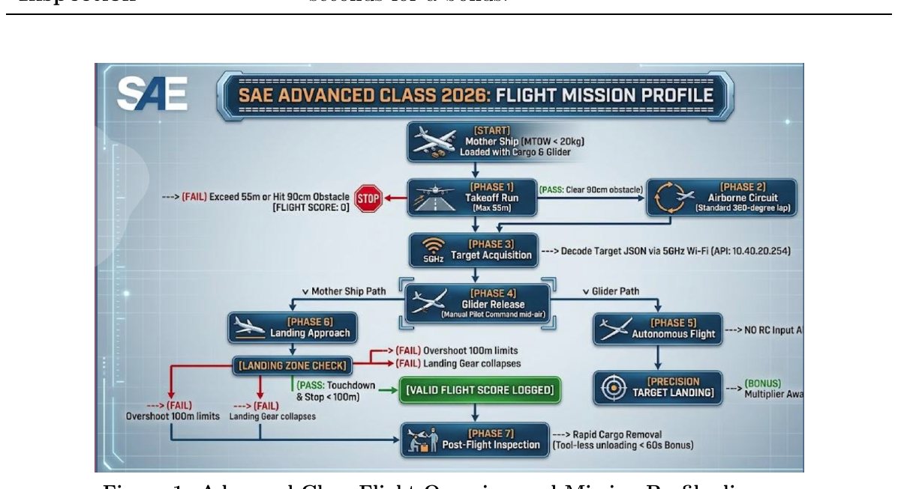
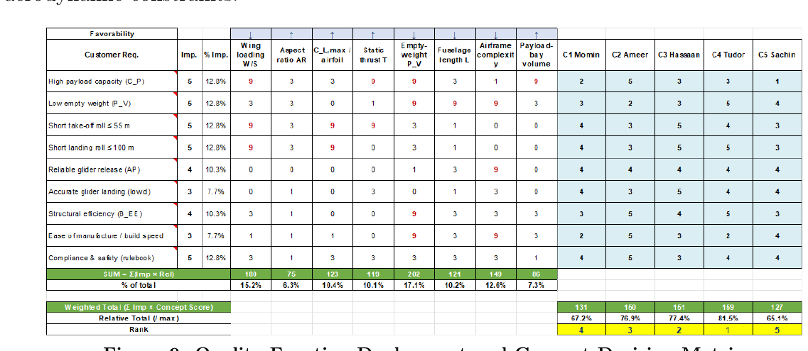
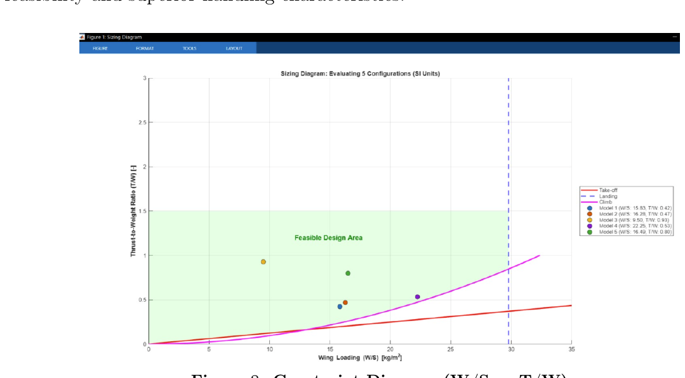
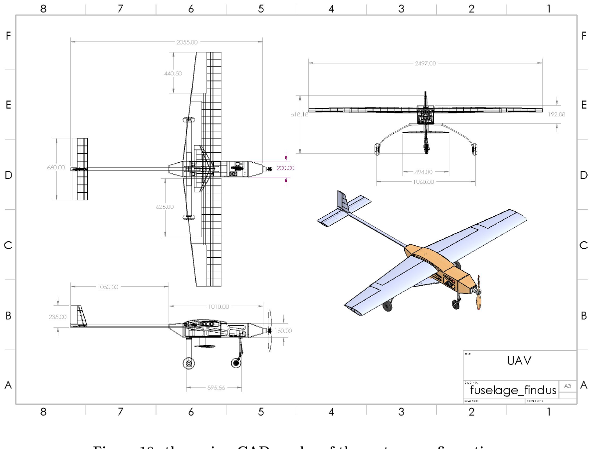
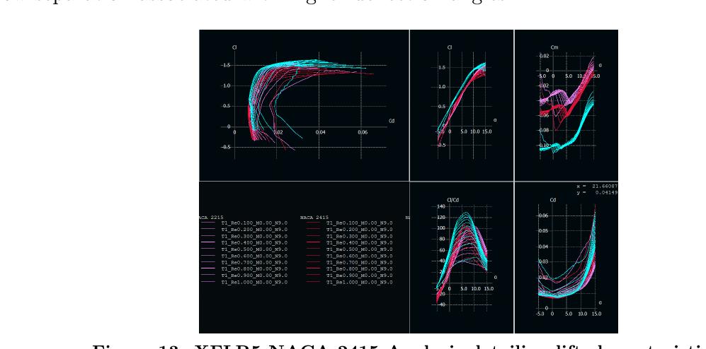
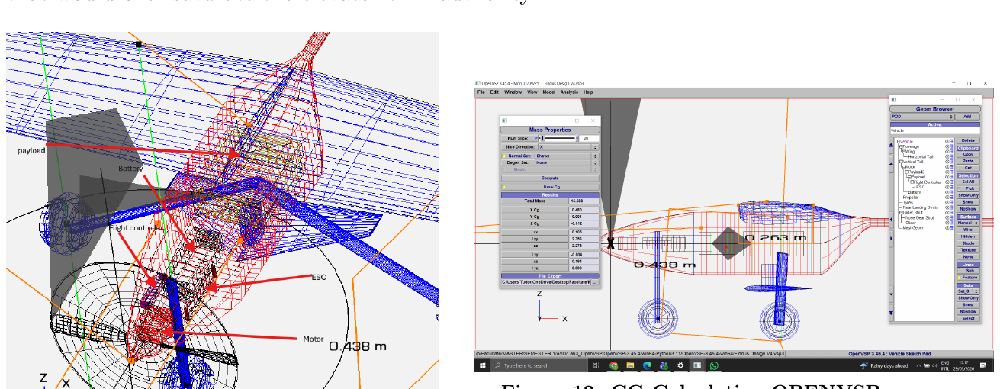

# Heavy-lift electric UAV, SAE BRASIL AeroDesign 2026 Advanced Class

**TMAL06 Aircraft Conceptual Design and Team Findus, Linköping University · March to June 2026**

| | |
|---|---|
| **Context** | TMAL06 final report, Linköping University, and the conceptual baseline for Team Findus at SAE BRASIL AeroDesign 2026 Advanced Class |
| **My role** | Team Captain and Lead Systems Engineer of Team Findus from December 2025. Systems integration lead for fuselage and landing gear. Compiled the technical report submitted to the competition |
| **Team** | Five students. Supervisor Ludvig Knöös Franzén, examiner David Lundström |
| **Tools** | OpenVSP, XFLR5, Raymer sizing methods, CAD, MATLAB |
| **Status** | Conceptual baseline complete. Structures, manufacturing and electrical design deliberately deferred to TMAL07 and TMAL08 |

> **Takeaway for a supervisor:** the aircraft is sized against a transient load case, not a cruise
> point. The design driver is what happens to the centre of gravity when a 1.0 kg glider leaves the
> aircraft in flight, and that event is carried analytically through to a static margin number.

---

## 1. Problem

SAE BRASIL Advanced Class scores payload carried, plus bonuses for a released autonomous glider,
light empty weight, stopping in the runway, data acquisition and autonomous landing. The rules impose
hard limits on take-off and landing field length, obstacle height, glider mass and cargo removal time.

That turns into a conceptual design problem with an unusual centre of gravity requirement: the
aircraft must be stable **fully loaded**, and still stable **immediately after** it drops a 1.0 kg
glider from a station aft of its own centre of gravity, without saturating elevator trim authority.



---

## 2. Design point

Five configurations were generated and scored through a quality function deployment and concept
decision matrix before one was carried forward.





The constraint diagram maps thrust to weight against wing loading, with take-off field length, landing
field length, climb and stall boundaries. The design point was **locked at a higher wing loading than
the minimum feasible**, which is a deliberate trade: it uses unused take-off margin to buy a smaller,
lighter wing.

| Design point | Value |
|---|---|
| Wing loading, W/S | **200 N/m2** (20.4 kg/m2) |
| Static thrust to weight, T/W | **0.56** |
| Take-off maximum lift coefficient | 2.0 |
| Take-off field length | **20.5 m** against a 55 m limit |
| Landing field length | **55.4 m** against a 100 m limit |
| Projected single-run flight bonus | approximately 70 points |

---

## 3. The aircraft

| Parameter | Value |
|---|---|
| Configuration | Fixed-wing, single tractor, electric, boom-and-pod fuselage, fixed tricycle gear |
| Wing | Tapered **NACA 2415**, span **2.50 m**, reference area **0.834 m2** |
| Empennage | Conventional, NACA 0010 |
| MTOW | **17.0 kg**, capped |
| Target empty weight | **6.0 kg** |
| Carried payload | **10.0 kg**, plus a **1.0 kg** releasable glider |
| Motor and propeller | T-Motor AM670, 520 KV, APC 17x8E, maximum static thrust **94.2 N** (9.6 kgf) |
| Battery | Ovonic 6S 10,000 mAh LiPo, isolated from avionics |
| Avionics | mRo Pixhawk 2.4.6, SIYI M9N, Holybro MS4525DO, SiK radio |
| Cruise condition | V = 20 m/s, rho = 1.096 kg/m3, São Paulo atmosphere |



---

## 4. Aerodynamics



**Section choice as a weight decision.** The NACA 2415 cuts the zero-lift pitching moment coefficient
by **53 per cent** against the earlier baseline, to |C_m,0| = 0.043. A smaller pitching moment means a
smaller horizontal tail moment requirement, which means a **smaller tail and less empty weight**. On
an aircraft scored on empty weight, an aerodynamic choice made for its structural consequence is the
right instinct.

**High lift.** Single-slotted trailing-edge flaps over 30 per cent of the chord, deflected 15 degrees
at take-off, give an increment of about **+0.5 C_L**, bridging the gap to the target take-off
C_L,max = 2.0 without the drag penalty and premature separation of a larger deflection.

**Parasite drag.** Component build-up following Raymer, with skin friction from the component Reynolds
number (laminar `Cf = 1.328/sqrt(Re)`, turbulent `Cf = 0.455/(log10 Re)^2.58`), form factors,
interference factors and wetted areas, plus a 2.5 per cent leakage and protuberance allowance.

| Result | Value |
|---|---|
| Aircraft parasite drag coefficient | **C_D0 = 0.02625** |
| Dynamic pressure in cruise | q = 219.2 Pa |
| Parasite drag force in cruise | D0 = 4.80 N |

Induced drag from finite-wing theory, `C_Di = C_L^2 / (pi AR e)`, gives the total drag polar. Because
the 2415 is cambered, the minimum drag region is shifted favourably away from zero lift.

**Flight envelope.** Available thrust was modelled as `T_A(V) = T_static [1 - (V/V_pitch)^1.5]` using
the Staples propeller method for the AM670 and APC 17x8E on 6S, and intersected with the drag curve
to bound level-flight speed.

---

## 5. Stability, and the design driver

A component-by-component mass build-up over 14 items gives the three-dimensional centre of gravity at
the 17.0 kg take-off condition.



| Quantity | Value |
|---|---|
| Centre of gravity, X | 0.4903 m from datum |
| Neutral point, X | 0.6287 m |
| Mean aerodynamic chord | 0.339 m |
| **Static margin, loaded** | **14.2 per cent** |

### The glider release

The glider sits at X = 0.603 m, aft of the loaded centre of gravity at 0.490 m. Releasing it therefore
shifts the centre of gravity **forward**:

```
X_CG,drop = (M_MTOW · X_CG - m_g · X_glider) / (M_MTOW - m_g)
          = (17.00 × 0.490 - 1.00 × 0.603) / 16.00
          = 0.483 m
```

A 7 mm forward shift, which over a 0.339 m mean aerodynamic chord is **+2.1 per cent** of static
margin.

| | Static margin |
|---|---|
| Fully loaded | 14.2 per cent |
| Immediately after glider release | **16.3 per cent** |

The aircraft becomes **more** stable at the release, not less, and the increase is small enough that
it does not produce a nose-down pitching moment that would over-saturate elevator trim authority.
That is the result the configuration was arranged to produce: the glider station was not chosen by
convenience of packaging.

---

## 6. Energy sizing

The Breguet range equation was modified for electric propulsion, where battery specific energy rather
than fuel fraction sets the minimum mass. At e_bat = 270 Wh/kg and a restricted depth of discharge,
the theoretical minimum battery mass is **0.43 kg**. The team deliberately carried more than the
minimum, an 0.82 kg pack, trading weight for margin on a competition flight where a dead battery on
the return leg scores zero.

---

## 7. Scope discipline

The report states plainly what is **not** in it. Structures and structural testing go to TMAL07
Prototype Realization; electrical design, onboard glider systems and the autopilot architecture go to
TMAL08 Aircraft Systems Engineering Project. Those sections appear as architecture-level placeholders
with the interface budgeted, not as hand-waving.

| SAE technical report | Points | Course | Status |
|---|---|---|---|
| Conceptual and preliminary design | 30 | TMAL06 | Complete |
| Aerodynamics | 25 | TMAL06 | Complete |
| Performance | 25 | TMAL06 | Complete |
| Stability and control | 25 | TMAL06 | Complete |
| Aeroelasticity and loads | 25 | TMAL06 | Complete |
| Structures and structural testing | 30 | TMAL07 | Deferred, interface budgeted |
| Electrical design and safety | 25 | TMAL08 | Deferred, interface budgeted |
| Onboard systems, glider | 25 | TMAL08 | Deferred, interface budgeted |

Knowing which 80 points you are not chasing this semester, and saying so in the report, is a project
management decision as much as an engineering one.

---

## 8. What I would do differently

- **CFD on the boom-and-pod junction.** The parasite drag build-up uses empirical interference factors
  for a configuration whose wing, boom and pod junctions are exactly where empiricism is weakest.
- **Propeller thrust from a test, not a model.** The Staples method is adequate for conceptual sizing,
  but static thrust drives the take-off field length, which is the binding constraint. A thrust stand
  measurement would replace the softest number in the performance chain.
- **Dynamic stability, not only static.** Static margin says the aircraft returns; it does not say how
  it returns. A short-period and phugoid check at the post-release condition would close that gap.
- **Sensitivity of the release event.** The 7 mm shift is computed for a nominal glider mass and
  station. A tolerance on both would show how much of the 2.1 per cent margin is real.

---

## 9. Relevance to a master thesis

This project is the evidence that I can run a multidisciplinary system to a deadline with real
constraints and a real customer, coordinate interfaces I do not own personally, and write the document
that gets assessed. It is also where I lead: captain and systems lead of a five-person team with an
external competition submission.

[Thesis readiness](../docs/thesis-readiness.md) · [Back to portfolio](../README.md)
