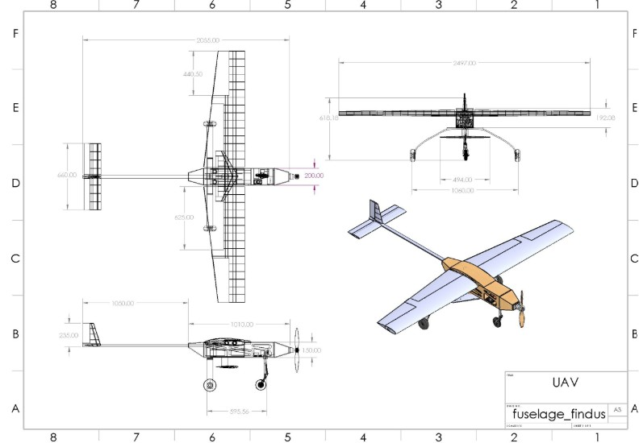

# Heavy-lift electric UAV, SAE Brasil AeroDesign Advanced Class

**Mar 2026 to Jun 2026 · TMAL06 project course and Team Findus, Linköping University**

**Role:** Team Captain and Lead Systems Engineer (Dec 2025 to present). Systems integration lead for
Team B, fuselage and landing gear.

## The problem

Advanced Class rules reward payload carried and mission completed, including the mid-air release of a
glider. That release moves the centre of gravity abruptly, which is a stability problem before it is
an aerodynamics problem.

## What was done

- Constraint optimisation over thrust to weight and wing loading to set the design point
- Wing section selection: a **NACA 2415** wing cut the zero-lift pitching moment by **53 per cent**
- Longitudinal stability carried through the release event: **static margin held positive, rising
  from 14.2 to 16.3 per cent** through mid-air release of a 1.0 kg glider
- Coordination of controls, aerodynamics and structures interfaces across a multidisciplinary team
- Compiled the technical report submitted to the competition

## Skills demonstrated

Systems engineering across discipline boundaries, interface ownership, and design decisions made
against a transient load case rather than a cruise point.
