# SKYLIGHT, conceptual design of a new midsize aircraft

**TMAL51 Aircraft Conceptual Design, Linköping University · January to June 2026**

| | |
|---|---|
| **Context** | TMAL51 design study, Linköping University. Three authors: Hassaan Shahid, Momin Ali Khan, Tanveer Hussain |
| **Supervision** | Industrial supervisor Raghu Chaitanya Munjulury, examiner Ludvig Knöös Franzén |
| **Tools** | BeX conceptual design environment, PreSTo-Cabin, singular value decomposition sizing, FAR Part 25 |
| **Deliverable** | 53-page design report with full sizing chain, geometry, aerodynamics, stability and flight envelope |
| **Status** | Complete, converged baseline, June 2026 |

> **Takeaway for a supervisor:** the study does not stop at a statistical estimate. It shows where the
> statistical model was wrong and why the physics-based synthesis had to replace it, which is the part
> of a conceptual design course that most reports skip.

---

## 1. Problem

The middle of the market is a real gap: long-range single-aisle aircraft are too small for it and
wide-bodies are too heavy for it. ETOPS routing puts a premium on twin-engine designs that can fly
4,500 to 5,000 nm with around 250 seats without wide-body operating cost.

**Design mission:** London Heathrow to Chicago O'Hare, 4,500 to 5,000 nm, 250 to 270 passengers, under
FAR Part 25.

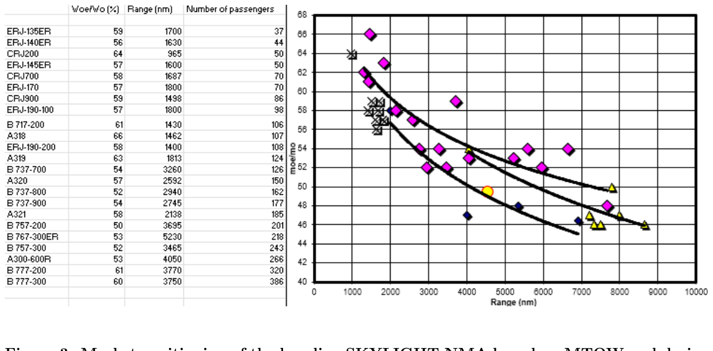

---

## 2. Method, and where the method broke

The design ran in two stages, and the comparison between them is the most instructive part.

**Stage one, statistical.** A singular value decomposition over a competitor database, using six SVD
variables, produced a baseline estimate with a **4 per cent residual error**. That number looks like
success.

**Stage two, physics-based synthesis.** Iterative sizing in BeX with PreSTo-Cabin, driven by actual
physical loads, aerodynamic drag and the specific mission profile. The converged aircraft differs from
the SVD prediction in ways the 4 per cent residual did not predict.

**The lesson recorded in the report:** SVD is a good tool for market insight and a rough starting
point. It cannot size an aircraft, because it has no mechanism, only correlation. A low residual on a
regression across existing aircraft says the regression fits those aircraft, not that it predicts a
new configuration. The SVD established the starting point; BeX produced the converged solution.

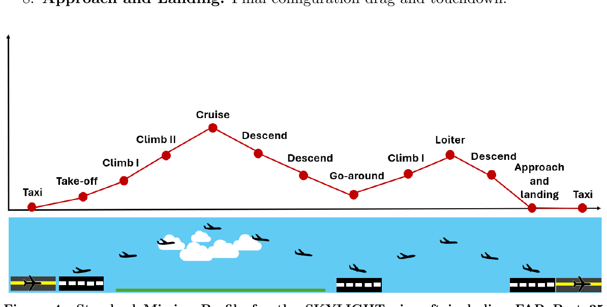

Mission segments: engine start and taxi, take-off, climb to an initial cruise altitude of 35,000 ft,
cruise at Mach 0.77, descent, approach and landing, plus FAR Part 25 reserves.

---

## 3. The converged aircraft

| Parameter | Baseline |
|---|---|
| Passenger capacity | **252**, single aisle, one class, 3-3 |
| Design mission | LHR to ORD |
| Design range, harmonic | **4,533 nm**, extending to 6,500 nm at design passenger payload |
| Fuselage length | 54.83 m |
| Pressurised cabin length | 28.2 m |
| Fuselage diameter | 4.53 m |
| **MTOW** | **212,957 kg** |
| Maximum landing weight | 199,454 kg |
| Maximum zero fuel weight | 158,183 kg |
| Operating empty weight | 105,463 kg |
| Design payload | 27,720 kg |
| Design mission take-off weight | 191,661 kg |
| Design mission fuel | 58,478 kg |
| Reference wing area | 406 m2 |
| Wingspan | 66.8 m |
| Aspect ratio | 11 |
| Quarter-chord sweep | 25.9 degrees |
| Cruise Mach | 0.77 |
| C_D,0 | 0.0160 |
| C_D,i | 0.0122 |
| **Cruise L/D** | **15.1**, with (L/D)max of **17.9** |
| Engine | Twin, BeX engine model at bypass ratio 8 |
| Doors | 8 Type-A |
| Low-speed static margin | 29.0 to 36.8 per cent |

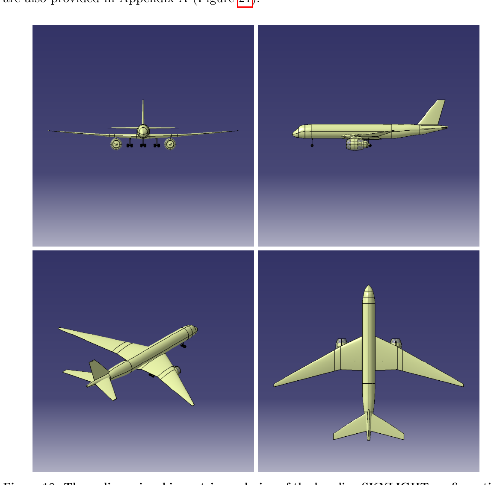

---

## 4. Configuration decisions and their justification

**Single aisle at 252 seats.** A twin-aisle layout at this capacity produces an unacceptably low
seats-per-unit-fuselage-length ratio: too much structure and wetted area for the payload. The 3-3
single aisle keeps the fuselage slender at the cost of slower boarding, which is an operating cost,
not a design cost.

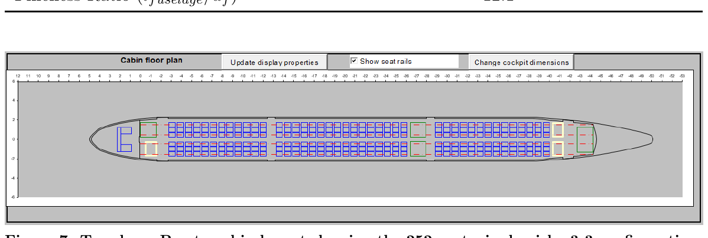

A stretched 272-seat two-class variant was also laid out, which is what makes the baseline a family
rather than a point design.

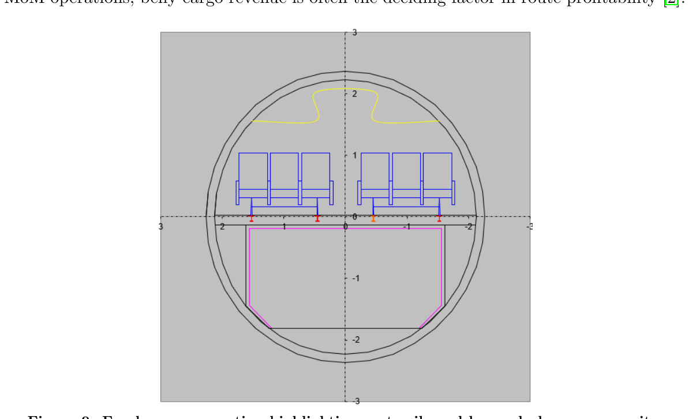

**Mach 0.77 rather than higher.** The initial market assumption pushed for more speed. BeX trade
studies showed the drag rise did not pay for itself on this mission, so the cruise Mach came down. A
market assumption overturned by an aerodynamic trade study, documented as such.

**High aspect ratio wing.** Aspect ratio 11 with 25.9 degrees of quarter-chord sweep, sized to keep
induced drag low at a cruise C_L consistent with the mission, and paired with a high bypass ratio
engine to minimise thrust specific fuel consumption.

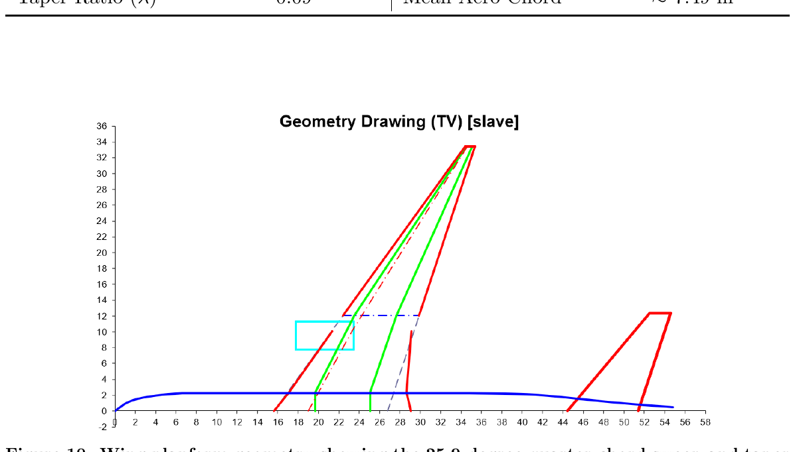

---

## 5. Sizing, aerodynamics and performance

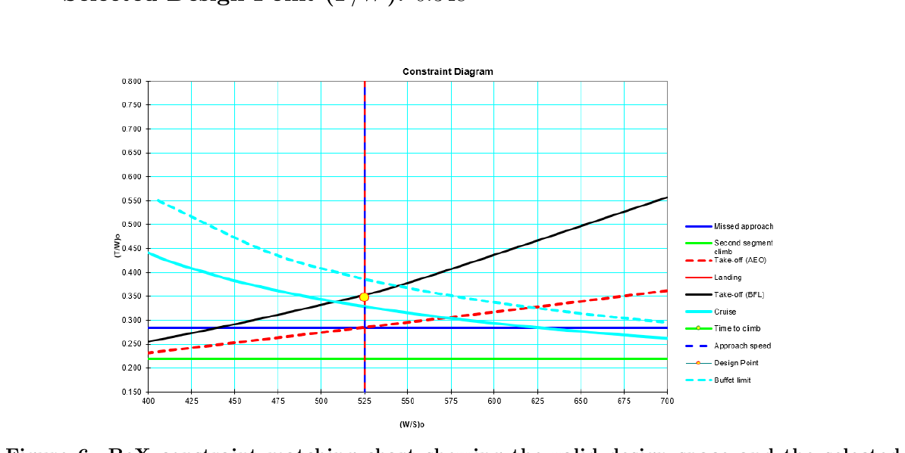

The constraint matching chart bounds the design space with take-off field length, second segment
climb, cruise and approach speed constraints. The design point sits inside that space with margin
rather than on a boundary.

| | |
|---|---|
| 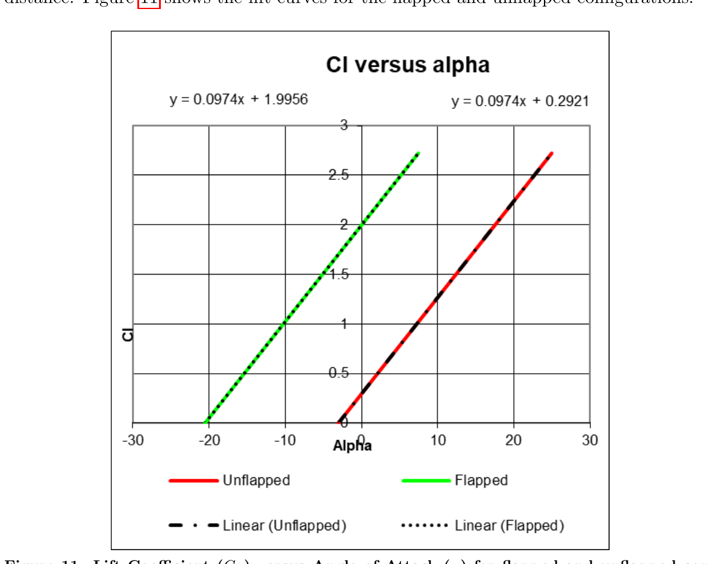 | 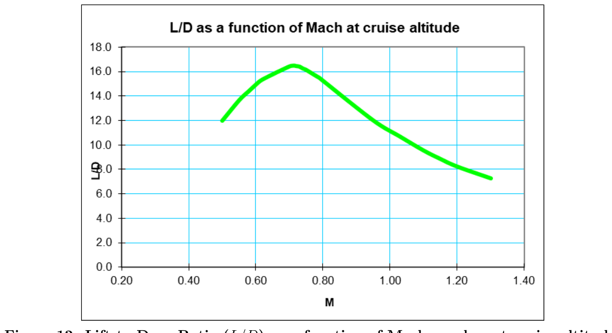 |
| High-lift: C_L against alpha, flapped and clean | Aerodynamic efficiency against Mach at cruise altitude |
| 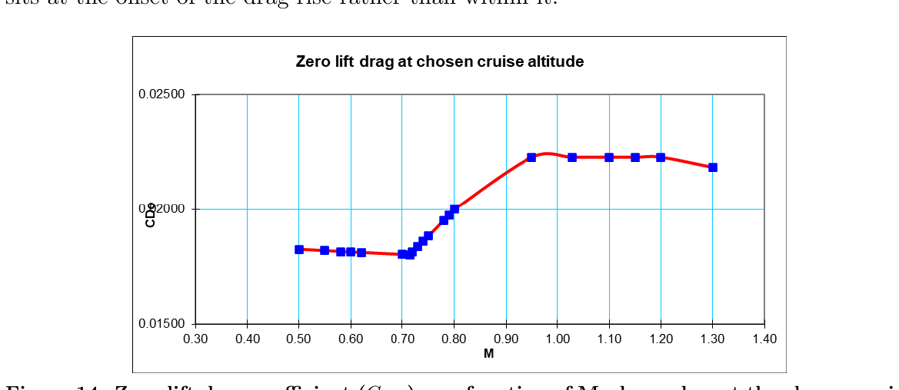 | 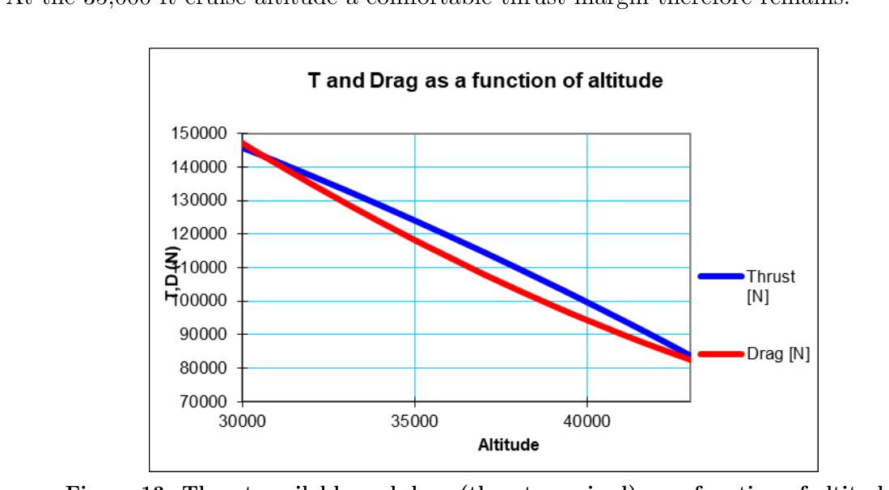 |
| Zero-lift drag against Mach, showing where drag rise begins | Thrust available against thrust required, bounding the ceiling |

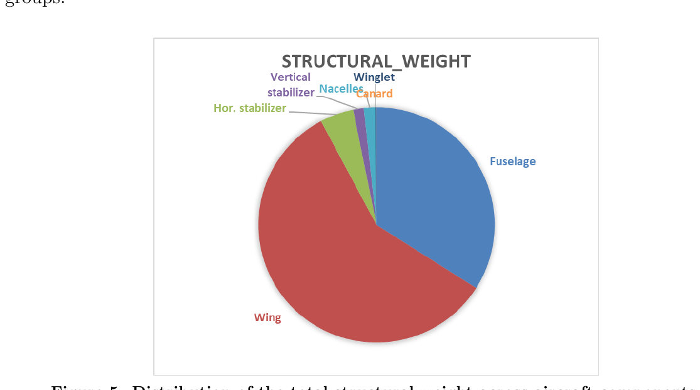

---

## 6. Stability, loading and certification envelope

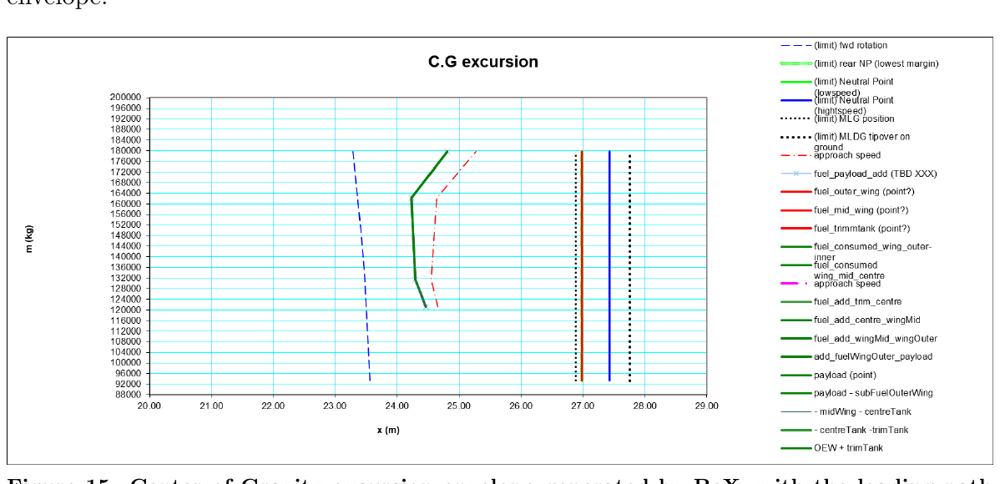

The centre of gravity excursion envelope is generated with the actual loading path on it: the aircraft
has to remain within limits through every realistic sequence of passenger and cargo loading, not only
at the two extreme states.

| | |
|---|---|
| 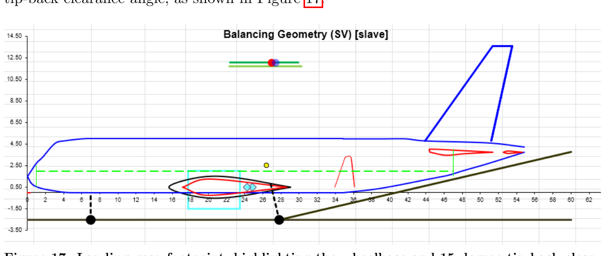 | 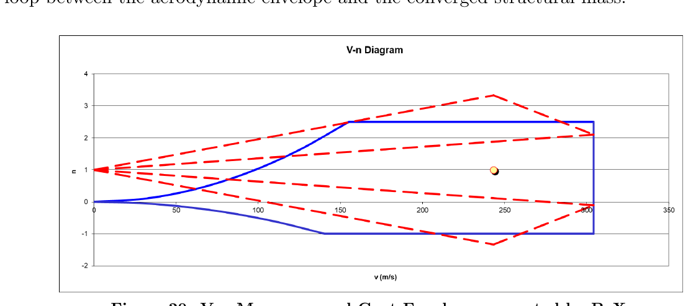 |
| Gear footprint, wheelbase and 15 degree tip-back clearance | V-n manoeuvre and gust envelope under FAR Part 25 |

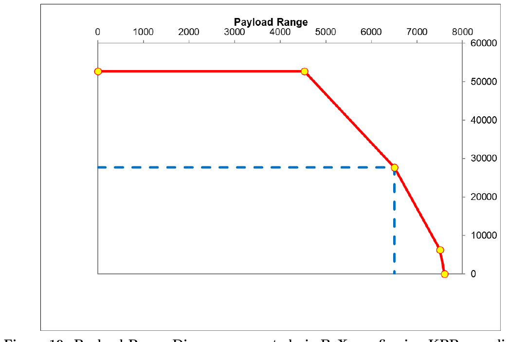

The payload-range diagram is where the whole design either closes or does not. Harmonic range of
4,533 nm at maximum payload, extending to 6,500 nm at design passenger payload, puts the aircraft
inside the 4,500 to 5,000 nm requirement with the payload the market asked for.

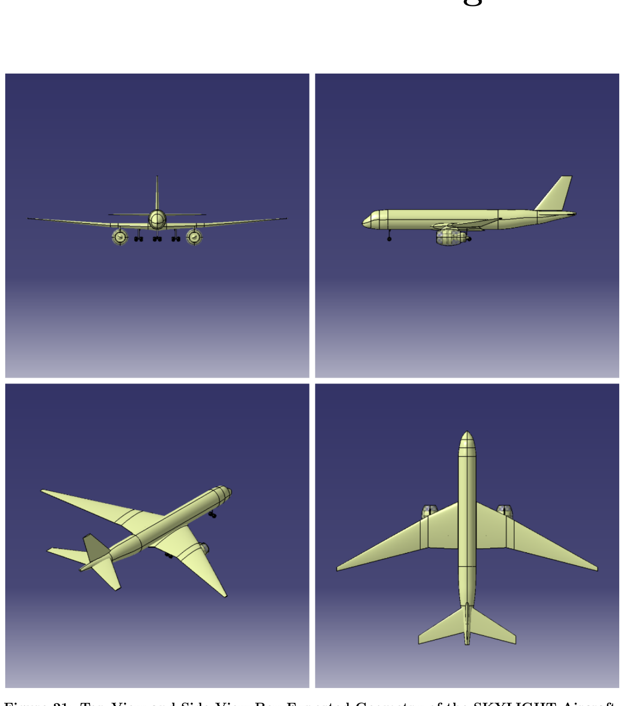

---

## 7. What I would do differently

- **Close the loop on the engine.** The propulsion model is a BeX cycle deck at bypass ratio 8. Sizing
  a real cycle, as I did for the micro turbojet in my degree project, would let the aircraft and the
  engine be converged together instead of sequentially.
- **Aeroelastic check on an aspect ratio 11 wing.** At 66.8 m span, wing bending and the resulting
  load alleviation are not second-order effects, and the conceptual chain here treats the wing as
  rigid.
- **Quantify the SVD-versus-BeX gap.** The report shows that the statistical prediction and the
  converged design differ. Turning that into a per-variable error table would make the lesson
  reusable, rather than an observation about one aircraft.
- **Direct operating cost.** The configuration decisions were argued on weight and drag. The market
  case they serve is economic, and the report does not close that loop with a DOC estimate.

---

## 8. Relevance to a master thesis

Conceptual design is where a supervisor finds out whether a student can hold an entire system in their
head, make a decision with incomplete information, and then check it. This study also happens to
contain the failure mode most relevant to a machine learning thesis: a statistical model with a
flattering error metric that could not size an aircraft, because it had correlation and no mechanism.

[Thesis readiness](../docs/thesis-readiness.md) · [Back to portfolio](../README.md)
