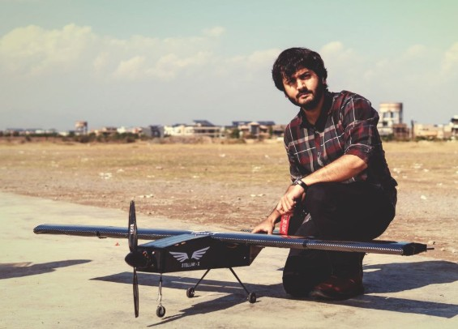

# Stellar-X surveillance UAV

**AIAA Student Chapter, Institute of Space Technology · 2024 to 2025**

 

| | |
|---|---|
| **Aircraft** | Lightweight electric surveillance UAV, developed from the Carbon-08 platform |
| **Process** | CAD modelling, aerostructural simulation, real-time embedded flight testing |

## Specification

| Parameter | Value |
|---|---|
| MTOW | 5.0 kg |
| Wingspan | 1.69 m |
| Cruise speed | 26.5 m/s |
| Endurance | 50 min |

## Engineering

| Area | Work |
|---|---|
| Design | Full airframe and internal layout modelled in SOLIDWORKS |
| Validation | ANSYS Structural and CFD, aerostructural load cases before build |
| Avionics | Pixhawk 2.4.8 flight controller, ELRS RadioMaster link, Caddx Ratel 2 FPV |
| Test | Real-time embedded flight testing and control tuning |

## The endurance number is the design

50 minutes at 5.0 kg on a 1.69 m span is an energy problem before it is an aerodynamic one. Everything
in the configuration, span loading, cruise speed selection and structural mass fraction, is being
traded against battery mass. That is the same trade that appears in the
[SAE heavy-lift UAV](sae-heavy-lift-uav.md), where the minimum battery mass was computed and then
deliberately exceeded for margin.

## Relevance

Design, simulate, build, fly, tune, with the same person responsible at each stage. A flying aircraft
is the least ambiguous validation a design method can have.

[Back to portfolio](../README.md)
