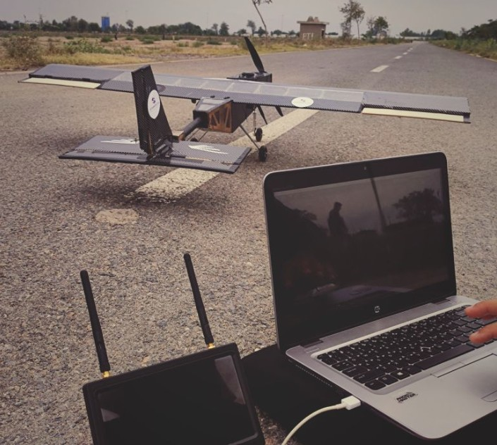
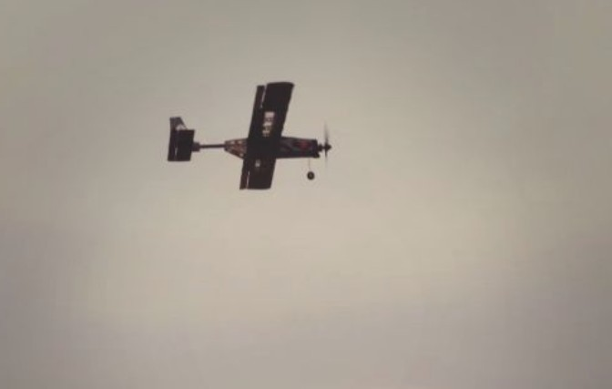

# Stellar-X surveillance UAV

**2024 to 2025 · AIAA Student Chapter, Institute of Space Technology**

 

## The aircraft

A lightweight electric surveillance UAV developed from the Carbon-08 platform, engineered through
CAD modelling, aerostructural simulation and real-time embedded flight testing.

| Parameter | Value |
|---|---|
| MTOW | 5.0 kg |
| Wingspan | 1.69 m |
| Cruise speed | 26.5 m/s |
| Endurance | 50 min |

## Engineering

| Area | Work |
|---|---|
| Design | Modelled in SOLIDWORKS, full airframe and internal layout |
| Validation | ANSYS Structural and CFD, aerostructural load cases |
| Avionics | Pixhawk 2.4.8 flight controller, ELRS RadioMaster link, Caddx Ratel 2 FPV |
| Test | Real-time embedded flight testing and tuning |

