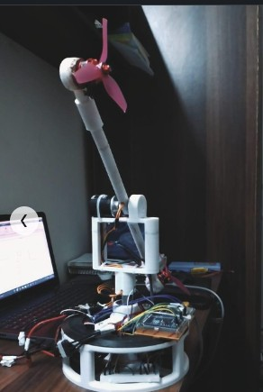

# Twin Rotor Aerodynamical System control laboratory rig

**Control systems and dynamics, Institute of Space Technology · December 2022 to July 2023**

| | |
|---|---|
| **Context** | Built a laboratory plant for high-order nonlinear control experiments |
| **My role** | Mechanical design, actuation, sensing and system identification setup |
| **Status** | Built and used for control experiments |

---

## 1. Why this plant

A twin rotor system behaves like a helicopter in the ways that make helicopters hard: it is **high
order**, **nonlinear**, and **strongly cross-coupled**, so a change in main rotor speed produces a yaw
moment as well as a pitch response. It is the standard hard case for system identification and
multivariable control design, and building it rather than buying it meant owning the sensing and the
identification as well as the controller.

## 2. Build

| Subsystem | Implementation |
|---|---|
| Mechanics | Beam pivoted for both horizontal and vertical rotation, with a counterbalance arm |
| Actuation | Main and tail rotors driven by DC motors, at fixed blade angle of attack |
| Sensing | Pivot encoders for the two angles, speed sensors for rotor angular velocities |
| Control principle | Aerodynamic forces are varied through rotor speed, not blade pitch |

Fixing the blade angle and controlling through rotor speed is what makes the plant tractable as a
teaching rig and keeps the nonlinearity where it is interesting: in the aerodynamics and the coupling,
not in the actuation.

## 3. What it is for

State variables are captured directly, angles from the encoders and rotor speeds from the speed
sensors, which is what a system identification experiment needs: a measured state vector rather than
an inferred one.

## 4. What I would do differently

- **Identify before controlling.** With the instrumentation in place, a proper input design, a chirp
  or a pseudo-random binary sequence rather than steps, would give a model good enough to design
  against rather than tune against.
- **Quantify the cross-coupling.** The coupling is the interesting property of the plant and it is
  qualitative in this build. A measured transfer function matrix would make it a teaching asset.

## 5. Relevance to a master thesis

Hardware, instrumentation and a nonlinear multivariable plant, built from scratch. The same instinct
that makes the Iron Bird rig work: if the model and the hardware are going to be compared, the
hardware has to be measurable first.

[Back to portfolio](../README.md)
