# Generic design and performance code for micro gas turbine UAV propulsion

**B.Sc. degree project, Institute of Space Technology, Islamabad · September 2024 to July 2025**

| | |
|---|---|
| **Context** | Final year degree project, Department of Aeronautics and Astronautics, IST Islamabad |
| **Authors** | Hassaan Shahid, Muhammad Bilal Sabir. Supervisor Dr Muhammad Naeem, PhD Cranfield |
| **Recognition** | **Nominated, Best Final Year Project 2025** |
| **Benchmark engine** | AMT Olympus HP 230N micro turbojet |
| **Tools** | C++, NPSS, MATLAB |
| **Artifacts** | 123-page thesis, [code repository](https://github.com/hassaanshahid97-cyber/uav-gas-turbine-performance-tool), [Zenodo archive](https://doi.org/10.5281/zenodo.21805835) |

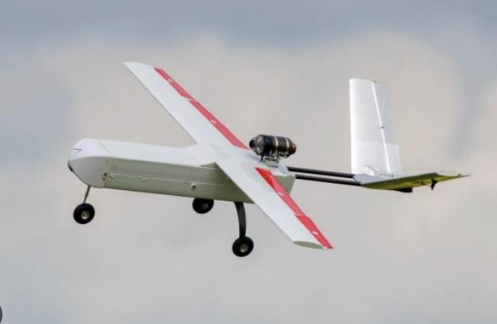

> **Takeaway for a supervisor:** a whole-vehicle tool rather than an engine deck. It couples a Brayton
> cycle model to an aerodynamic build-up and a second-by-second mission simulator, so it answers a
> design question instead of producing a cycle table.

---

## 1. The gap

Micro turbojets give tactical and surveillance UAVs the power-to-weight ratio and throttle response
they need. The open literature lacks an accessible computational model that unifies **thrust, RPM,
specific fuel consumption and aerodynamic drag** for a validated engine under realistic mission
conditions. Engine decks exist; vehicle performance tools exist; the coupling is what is missing.

The question the tool is built to answer, stated plainly: *can this airframe, with this engine, clear
the obstacle at this weight?*

---

## 2. Architecture

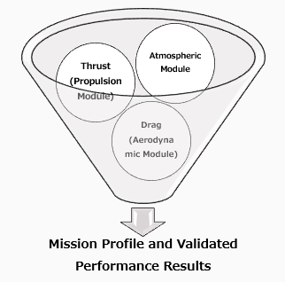

| Module | Responsibility |
|---|---|
| Atmospheric model | Standard atmosphere, density, temperature and pressure with altitude |
| Aerodynamic vehicle design build-up | Lift, drag and flight performance from wetted-area build-up, skin-friction coefficients and Oswald efficiency |
| Engine cycle | Thrust, TSFC, RPM and fuel flow across altitude, Mach number and throttle |
| Mission simulator | Ground roll, transition, climb, cruise, payload drop, descent, second by second |
| Visualisation | Real-time trajectory animation with live thrust, drag, rate of climb and fuel readouts |

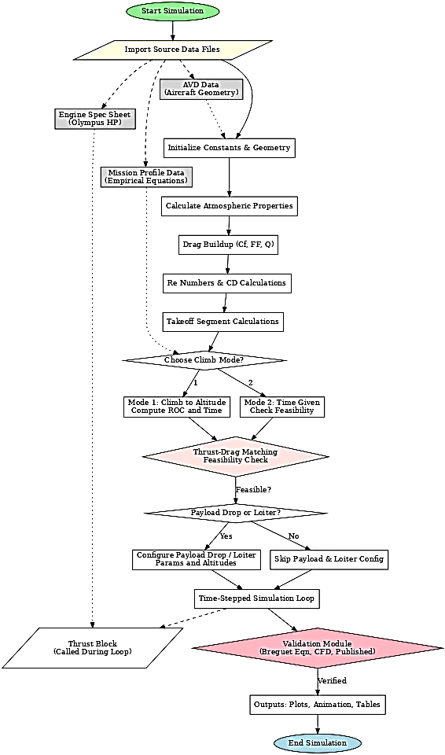

The tool is **self-contained and offline** by design. Propulsion evaluation needs no external service
and no licensed package at run time, which is what makes it usable in a place where the licence is the
binding constraint.

---

## 3. Benchmark engine and cycle

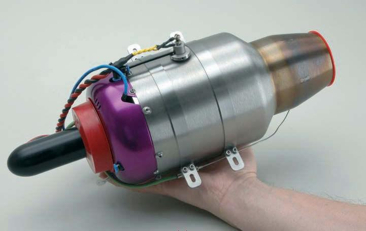 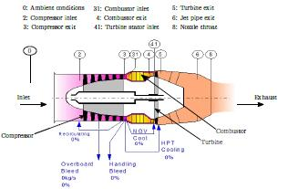

| Parameter | Value |
|---|---|
| Static thrust at sea level | 230 N |
| Maximum RPM | 108,500 rpm |
| Idle RPM | approximately 35,000 rpm |
| Compressor pressure ratio | approximately 3.8 |

---

## 4. Validation against manufacturer data

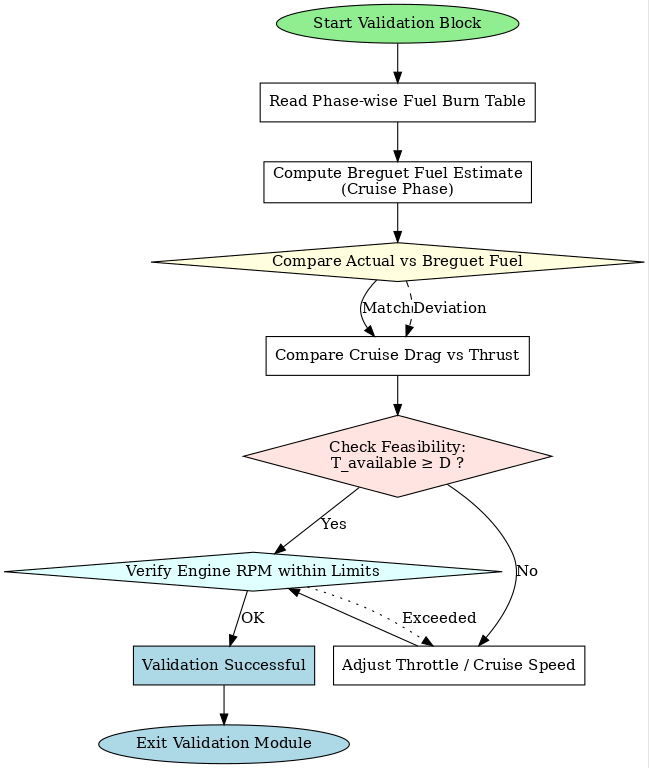

The engine model was cross-checked against Olympus HP manufacturer test data and published engine
maps, component by component rather than on total thrust alone.

| | |
|---|---|
|  | 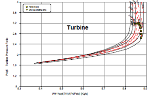 |
| Compressor map | Turbine map |
| 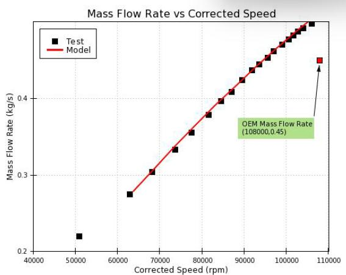 | 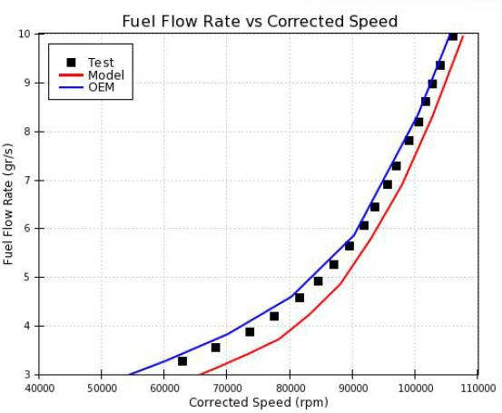 |
| Mass flow against corrected speed | Fuel flow against corrected speed |
| 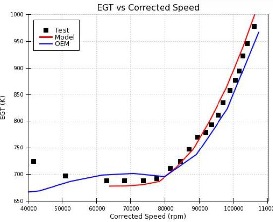 | 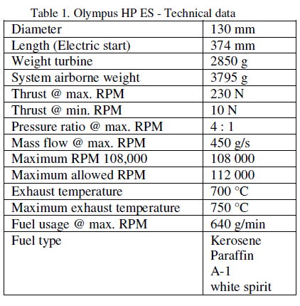 |
| Total-to-total efficiency | Exhaust gas temperature against corrected speed |

Validating against a map rather than a single operating point is the difference between a model that
matches at one throttle setting and a model that behaves correctly across the envelope.

---

## 5. Mission simulation, and the question it answers

 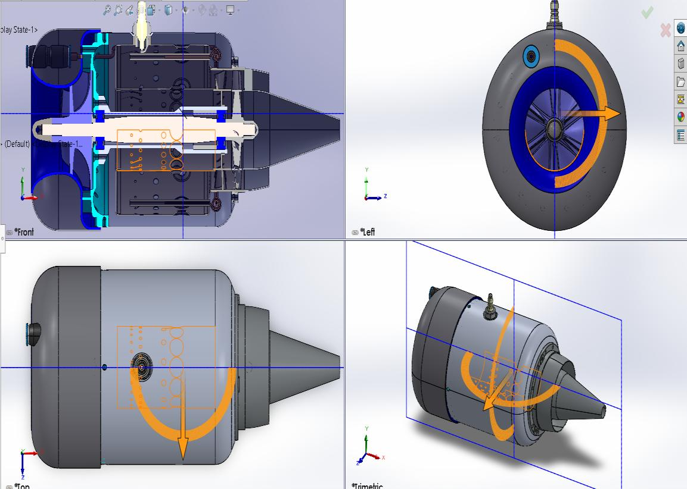

The mission runs phase by phase and second by second, so the coupling between propulsion and vehicle
shows up where it matters: at the obstacle.

| | |
|---|---|
| 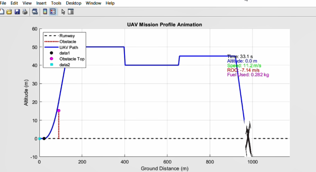 | 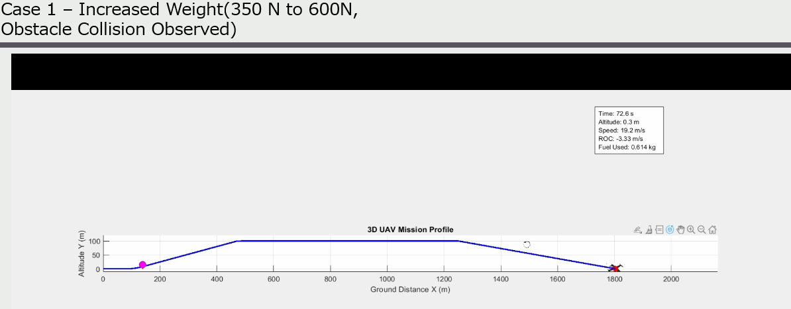 |
| **Cleared.** Compatible engine and take-off weight | **Not cleared.** Same engine, increased weight |
| 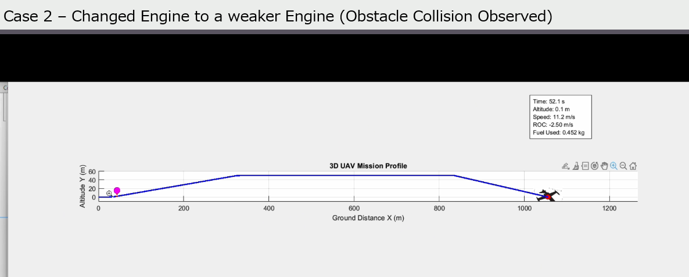 | 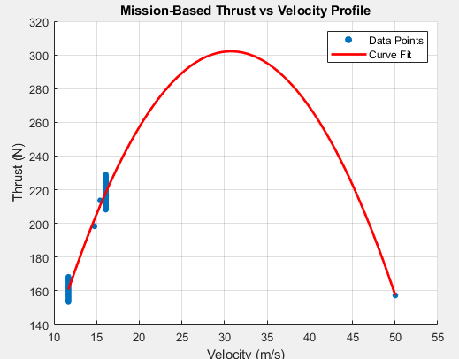 |
| **Not cleared.** Same weight, weaker engine | Thrust against velocity |

Three runs of the same mission with one variable changed each time. This is the tool being used as a
design instrument rather than a calculator: it separates "the engine is too small" from "the aircraft
is too heavy", which are the same failure on the runway and different decisions in the office.

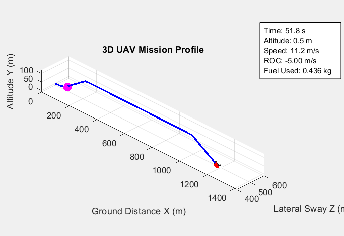

---

## 6. What I would do differently

- **Quantify the validation.** The model is compared against manufacturer maps graphically. Reporting
  a per-map RMS error would turn "agrees well" into a number, which is what a user of the tool
  actually needs in order to know what to trust.
- **Component efficiency sensitivity.** Compressor and turbine efficiencies are the least certain
  inputs and they propagate straight into TSFC. A sensitivity sweep would bound the mission fuel
  prediction.
- **Transient response.** The cycle is quasi-steady. Throttle response is one of the reasons a
  turbojet is chosen for this class of UAV, and it is the one thing the model cannot predict.
- **Tests around the mission integrator.** The code is a research tool with no regression tests. The
  obstacle-clearance result depends on an integration path that nothing currently protects.

---

## 7. Relevance to a master thesis

Propulsion system modelling, cycle analysis, validation against measured data and whole-vehicle
performance coupling, carried out to a nominated degree project and then published as an archived,
citable artefact. It is directly adjacent to my autumn course TMMV12 Gas Turbine Engines and to thesis
work on propulsion performance, digital twins or limit protection.

[Code](https://github.com/hassaanshahid97-cyber/uav-gas-turbine-performance-tool) ·
[Archive](https://doi.org/10.5281/zenodo.21805835) ·
[Thesis readiness](../docs/thesis-readiness.md) · [Back to portfolio](../README.md)
