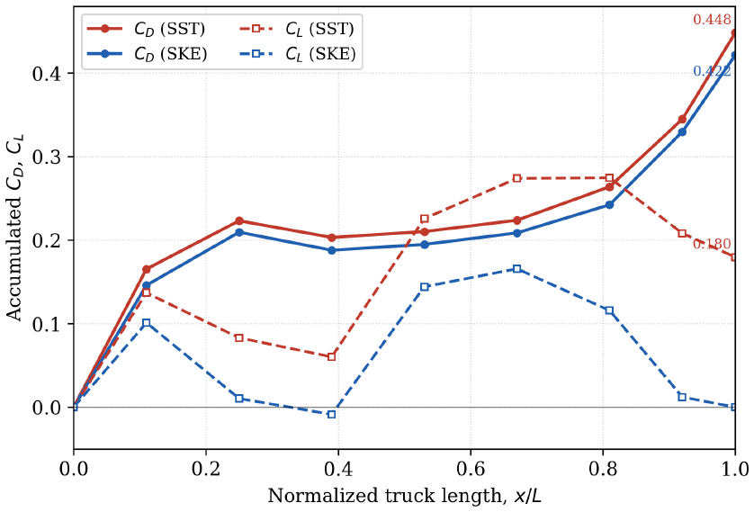
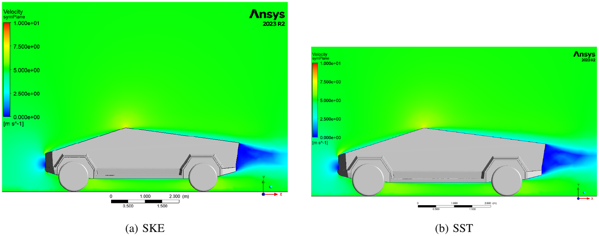
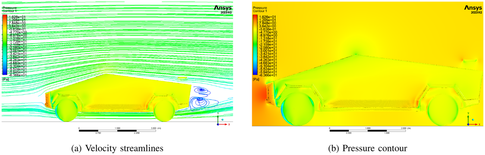
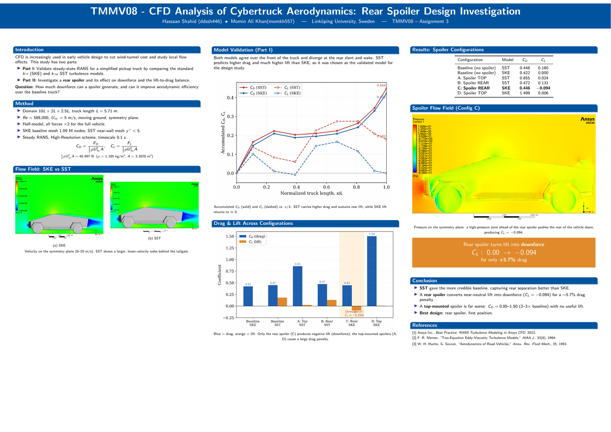

# Vehicle aerodynamics and rear spoiler integration, steady RANS

**TMMV08 Computational Fluid Dynamics, Linköping University · March to June 2026**

| | |
|---|---|
| **Context** | TMMV08 Assignment 3, Linköping University. Two authors: Hassaan Shahid, Momin Ali Khan |
| **My contribution** | Study conception and design, case setup and simulations, analysis and interpretation, report preparation, shared with my co-author |
| **Tools** | ANSYS CFX and CFD-Post, ANSYS meshing, LaTeX |
| **Deliverable** | Four-page technical report and A3 conference poster |
| **Status** | Complete, June 2026 |

> **Takeaway for a supervisor:** the study is built as a validation first and a design study second. The
> turbulence model was chosen on evidence before any geometry conclusion was drawn, and the final
> recommendation reports the drag cost next to the downforce gain.

---

## 1. Problem

Two questions, deliberately kept separate.

**Part I, credibility.** Can steady-state RANS be trusted on a simplified full-size pickup truck, and
does the choice between the standard k-epsilon model and the k-omega SST model change the answer?
Bluff-body vehicle flow separates and reattaches, and the two models treat the adverse pressure
gradient over a rear slant very differently.

**Part II, design.** How much downforce can a single-element rear spoiler generate, and does it
improve the lift-to-drag balance rather than simply adding drag?

---

## 2. Setup

| Parameter | Value |
|---|---|
| Reference vehicle length, L | 5.7068 m |
| Domain | 10L by 2L by 2.5L, vehicle 3.5L from the inlet, outlet 6.5L downstream |
| Reynolds number | **588,000** |
| Freestream velocity | 5 m/s, with a **moving ground** at 5 m/s to mimic outdoor conditions |
| Symmetry | Longitudinal centre plane, half model, all forces doubled before coefficients |
| Baseline SKE mesh | 1,086,846 nodes, **3.2 million elements** |
| SST near-wall mesh | Refined inflation layers, first layer height 0.35 mm, **y+ < 5**, first node inside the viscous sub-layer |
| Mesh sensitivity | Bulk refinement factor of approximately 1.4 |
| Advection scheme | High Resolution, physical timescale 0.1 s to damp unsteady wake instabilities |
| Initialisation | The SST case was started from the converged SKE field to aid convergence |
| Reference area and dynamic head | A = 3.3078 m2, rho = 1.185 kg/m3, giving a fixed denominator of **48.997 N** |

Coefficients: `C_D = F_D / (0.5 rho U^2 A)` and `C_L = F_L / (0.5 rho U^2 A)`.

**Convergence.** RMS residuals showed the characteristic sawtooth oscillation around 1e-4, which is
expected of a steady solver resolving inherently unsteady wake shedding behind a bluff body.
Convergence was judged on the drag force monitor settling to a stable value, not on the residual
alone. That distinction matters: a residual that will not fall below 1e-4 is not automatically a
failed run, and a run whose force monitor is still drifting is not converged however low the residual.

---

## 3. Part I, turbulence model validation

Accumulating the force coefficients along the vehicle rather than reporting only the totals shows
**where** the models disagree. Both agree over the front fascia. They diverge along the slanted roof
and into the rear wake.

| Model | C_D | C_L |
|---|---|---|
| Standard k-epsilon (SKE) | 0.422 | approximately 0.000 |
| k-omega SST | **0.448** | **0.180** |

Plotted over an identical 0 to 10 m/s range, the velocity fields explain the force difference. Through
its k-omega near-wall formulation the SST model captures separation at the slant apex more sharply and
predicts a larger, lower-velocity recirculation region behind the tailgate, which is consistent with
its higher base drag.

**Decision:** SST was adopted as the validated model. The spoiler configurations were then run with
**both** models, so that a design conclusion could be checked for model dependence rather than
inherited from one solver setting.

---

## 4. Part II, spoiler integration

A single-element rear spoiler, air passing on one side only, sized within the assignment constraints
(length ≤ 0.1L, width ≤ 1W, height ≤ 0.25H) at approximately 0.1L long, 0.9W wide and 0.1H high, and
modelled as a free-floating deflector with the wall mounts ignored. Two locations were tested, the
top of the slant and the trailing edge of the tailgate, each with both turbulence models.

### Full-vehicle results

| Configuration | Model | F_D [N] | F_L [N] | C_D | C_L |
|---|---|---|---|---|---|
| Baseline, no spoiler | SST | 21.957 | 8.800 | 0.448 | 0.180 |
| Baseline, no spoiler | SKE | 20.655 | 0.004 | 0.422 | 0.000 |
| A, spoiler top of slant | SST | 41.870 | 1.180 | 0.855 | 0.024 |
| B, spoiler rear, trailing edge | SST | 23.148 | 6.401 | 0.472 | 0.131 |
| **C, spoiler rear, first position** | **SKE** | 21.832 | **-4.607** | **0.446** | **-0.094** |
| D, spoiler top of slant | SKE | 73.438 | 0.285 | 1.499 | 0.006 |

### What the numbers say

- **Configuration C is the design success.** The rear spoiler flips a near-neutral baseline lift into
  **C_L = -0.094**, about **4.61 N of genuine downforce** on the full vehicle, for a drag rise from
  0.422 to 0.446, a **5.7 per cent** penalty. The pressure field shows why: a localised high-pressure
  zone forms ahead of the deflector and pushes the rear of the vehicle toward the road.
- **The trend is model-independent, the magnitude is not.** Configuration B, the same rear position
  under SST, still produces positive lift but cuts it from 0.180 to 0.131. Both models agree that the
  rear position helps the lift balance and keeps drag near baseline; they disagree on how much.
  Reporting only Configuration C without this would overstate the result.
- **The top-of-slant position is a clear failure**, and usefully so. C_D rises to 0.855 under SST and
  1.499 under SKE, two to three times baseline, for almost no lift benefit, C_L between 0.006 and
  0.024. Mounting the deflector on the roof line puts it in high-momentum free stream and adds large
  pressure drag.

---

## 5. Conclusion

The SST model gave the more credible baseline, resolving rear-slant separation better than SKE. A
rear-mounted spoiler converts near-neutral lift into downforce for a modest drag penalty, while a
top-mounted spoiler is a poor trade at any model setting. For early-stage exterior design, where the
question is "which concept is worth building", RANS at this level answers it.

---

## 6. What I would do differently

- **Unsteady simulation for the wake.** The sawtooth residual is the solver telling us the wake is
  inherently unsteady. A URANS or DES run behind the tailgate would put error bars on the base drag
  rather than leaving it as a steady approximation.
- **A grid convergence index, not just a refinement factor.** A refinement factor of 1.4 was applied;
  computing a formal GCI over three grids would turn mesh sensitivity into a number in the results
  table instead of a procedure in the method.
- **Model the spoiler mounts.** They were ignored. Mounts sit in exactly the high-pressure region that
  produces the downforce, so their drag contribution is not obviously negligible.
- **Resolve the disagreement rather than reporting it.** The honest version of this study says the two
  models differ on the rear; the better version would settle which is right against wind tunnel data.

---

## 7. Artifacts

- Four-page technical report, IEEE format, with full method, table and figures
- A3 conference poster

**Generative AI disclosure, carried over from the report:** Google Gemini was used to structure the
LaTeX formatting, draft narrative flow and refine grammatical clarity. All numerical results and
analytical conclusions are from our own CFD simulations, and the authors take full responsibility for
the content.

---

## 8. Relevance to a master thesis

This is the CFD half of a thesis in machine learning applied to fluid dynamics: a case whose numerical
error is characterised before it is used, model selection made on evidence, and a result reported with
its cost. Training data whose own discretisation and model error is unknown produces a surrogate whose
error is unknowable.

[Thesis readiness](../docs/thesis-readiness.md) · [How I verify](../docs/verification-practice.md) ·
[Back to portfolio](../README.md)
